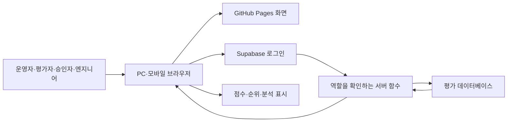
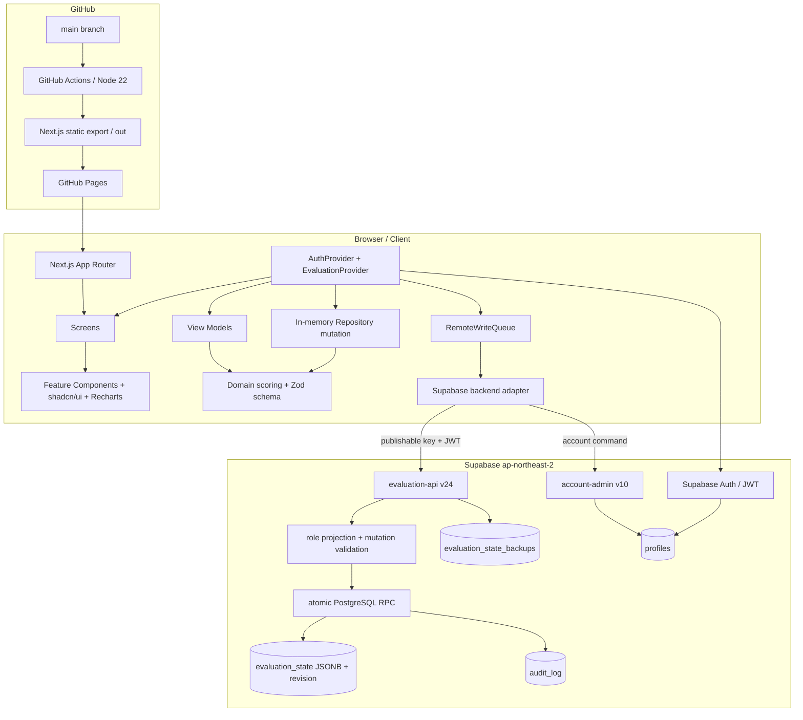
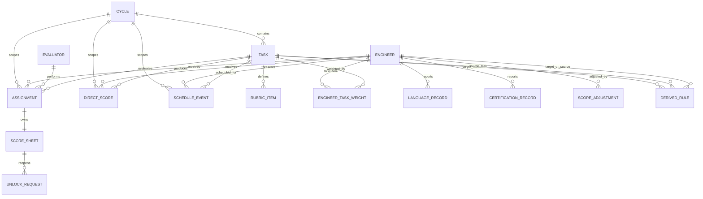
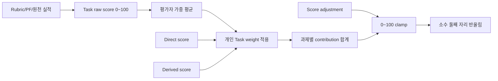
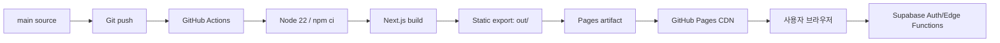

# 엔지니어 역량평가 시스템 기술·아키텍처 설명서

> 실사 기준일: 2026-08-16 (Asia/Seoul)<br>
> 실사 대상: `C:\llmwiki\engineer-evaluation-dashboard`의 현재 소스, Git 저장소, GitHub Pages 배포 상태, 연결된 Supabase 프로젝트의 스키마·함수·집계 상태<br>
> 기준 커밋: `b8fc255b6107f0e6168e221a1973bc65a2ba6680`<br>
> 개인정보 처리: 운영 데이터의 개인 이름·개별 점수는 조회하거나 기재하지 않았다. 인원 수와 상태 건수만 집계했다. 키·토큰·비밀번호·서비스 역할 키는 모두 `***MASKED***`로 다룬다.

## 문서 판독 기준

- **확인됨**: 현재 저장소 파일, Git/GitHub 상태 또는 연결된 Supabase 프로젝트에서 직접 확인한 사실이다.
- **분석/추론**: 확인된 구현을 바탕으로 예상한 운영 영향이나 확장성 판단이다.
- 파일 경로는 별도 표시가 없으면 저장소 루트 `C:\llmwiki\engineer-evaluation-dashboard`를 기준으로 한다.
- 이 문서는 제품 안내서가 아니라 기술 실사 보고서다. 화면에 보이는 기능뿐 아니라 저장·권한·계산·배포·복구 경계를 함께 설명한다.

---

## 0. 프로젝트 식별 정보

| 항목 | 확인 결과 | 근거 |
|---|---|---|
| 프로젝트명 | 엔지니어 역량평가 대시보드 / 패키지명 `engineer-evaluation-dashboard` | `README.md`, `package.json` |
| 저장소 경로 | `C:\llmwiki\engineer-evaluation-dashboard` | 현재 작업 경로 |
| Git 저장소 | `https://github.com/beliefin/engineer-evaluation-dashboard.git` | `git remote -v` |
| 현재 브랜치 | `main` | `git branch --show-current` |
| 현재 커밋 | `b8fc255b6107f0e6168e221a1973bc65a2ba6680` | `git rev-parse HEAD` |
| 패키지 버전 | `0.1.0` | `package.json` |
| 마지막 커밋 | `Add engineer evaluation story`, 2026-08-13 13:22:12 +09:00 | `git log -1` |
| 마지막 주요 기능 | 개인 상세의 점수·순위·백분위·강약점·과제 비교를 한 화면에서 보여 주는 평가 스토리 | `src/view-models/engineer-story.ts`, `src/features/engineers/engineer-evaluation-story.tsx` |
| 배포 방식 | `main` 푸시 → GitHub Actions → Next.js 정적 내보내기(static export) → GitHub Pages | `.github/workflows/pages.yml`, `next.config.ts` |
| 실제 운영 URL | `https://beliefin.github.io/engineer-evaluation-dashboard/` | GitHub Pages 설정 및 HTTP 200 확인 |
| 배포 실행 | GitHub Actions run `31666806914`, 성공, 배포 SHA가 현재 커밋과 동일 | GitHub Actions API |
| Supabase 프로젝트 | 이름 `Engineer Evaluation`, ref `kwfjvafyjprbgfzvugnl`, 서울 리전 `ap-northeast-2` | Supabase Management API |
| Supabase 상태 | `ACTIVE_HEALTHY`, PostgreSQL 17 (`17.6.1.141`) | Supabase Management API |
| Supabase URL | `https://kwfjvafyjprbgfzvugnl.supabase.co` | 프로젝트 API URL. 키는 기재하지 않음 |
| 로컬 Node.js | `v24.15.0` | `node --version` |
| 배포 Node.js | `22` | `.github/workflows/pages.yml` |
| 핵심 프레임워크 | Next.js `16.2.10`, React `19.2.4`, TypeScript `5`, Tailwind CSS `4`, Supabase JS `2.110.5` | `package.json`, `package-lock.json` |
| 실사 시 재검증 | lint 통과, Vitest 92파일·381개 통과, Next.js 19개 정적 page build 통과 | `npm run lint`, `npm run test`, `npm run build` |

### 개발·테스트·운영 모드

1. **개발 모드**: `npm run dev`가 Next.js 개발 서버를 시작한다. `src/components/react-dev-tools.tsx`는 개발 보조 도구를 담당한다.
2. **로컬 샘플 모드**: Supabase 공개 설정이 없거나 `NEXT_PUBLIC_BACKEND_MODE=local`이면 인증과 평가 상태를 브라우저 로컬 저장소(LocalStorage)에 둔다. `src/auth/repository.ts`, `src/repository/local-storage.ts`가 이 경로다.
3. **자동 테스트 모드**: Playwright는 기본적으로 Supabase 환경변수를 비워 로컬 샘플 모드에서 결정론적으로 실행한다. `playwright.config.ts`의 `webServer.env`가 이 경계를 만든다.
4. **운영 모드**: GitHub Pages 빌드 시 저장소 변수의 `NEXT_PUBLIC_SUPABASE_URL`, `NEXT_PUBLIC_SUPABASE_PUBLISHABLE_KEY`를 주입한다. 브라우저는 정적 프론트엔드를 내려받고, 인증·저장은 Supabase Auth와 Edge Function에 요청한다.

### 현재 코드와 실제 배포본의 관계

**확인됨**: 현재 로컬 HEAD와 최신 성공한 Pages 배포의 `headSha`가 모두 `b8fc255...`다. 운영 URL도 HTTP 200으로 응답한다. 따라서 이 보고서의 프론트엔드 분석은 현재 배포본과 같은 소스 기준이다. Supabase Edge Function은 `evaluation-api` v24와 `account-admin` v10이 활성 상태이며, 배포 함수의 파일 목록과 줄바꿈을 정규화한 파일 크기를 로컬 `supabase/functions` 소스와 대조했다. 구성은 일치했지만, 이 비교를 소스 전체의 암호학적 동일성 증명으로 확대 해석하지는 않는다.

---

## 1. 시스템을 한눈에 이해하는 Executive Summary

1. **무엇을 하는가**: 평가 시즌, 과제, 문항, 평가자 배정, 직접 실적, 파생점수, 개인 가·감점을 한곳에서 관리하고 엔지니어별 최종점수·순위·분석을 계산하는 웹 서비스다.
2. **사용자**: 운영자(operator), 평가자(evaluator), 승인자(approver), 엔지니어(engineer)가 사용한다.
3. **주요 기능**: 시즌·과제 설정, 명단·계정 관리, 평가자 배정, 평가 입력·제출·잠금 해제, 어학·자격증 입력, 일정, 미평가 추적, 대시보드, 개인 상세, 신뢰도·상대순위 분석, Excel 출력, 백업·복구다.
4. **기술 조합**: Next.js와 React가 화면을 만들고 TypeScript와 Zod가 데이터 형식을 지킨다. Tailwind CSS와 shadcn/ui가 UI를 구성하고 Recharts가 차트를 그린다. Supabase가 로그인, 서버 함수, PostgreSQL 저장을 맡는다.
5. **데이터 저장 위치**: 운영 상태는 Supabase PostgreSQL의 `evaluation_state.snapshot` JSONB에 있고, 계정 연결은 `profiles`, 변경 이력은 `audit_log`, 백업은 `evaluation_state_backups`에 있다.
6. **웹 서비스 위치**: 화면 파일은 GitHub Pages에서 정적 파일로 서비스된다.
7. **로그인과 권한**: Supabase Auth가 비밀번호를 검증하고 `profiles`가 역할·활성 상태·명단 연결을 정한다. Edge Function이 요청마다 역할을 다시 검사하고 필요한 데이터만 반환한다.
8. **점수와 순위 계산 위치**: 핵심 공식은 브라우저와 Edge Function이 함께 사용하는 TypeScript 도메인 코드 `src/domain/scoring.ts`에 있다. 서버는 저장 전에 같은 저장소 변이 규칙을 적용한다.
9. **여러 기기에서 같은 데이터가 보이는 원리**: PC와 모바일은 각자 GitHub Pages의 같은 정적 앱을 실행하지만, 인증 후 같은 Supabase 프로젝트의 최신 `evaluation_state`를 읽는다.
10. **한 문장 정의**: **정적 웹 프론트엔드와 역할 기반 Supabase 백엔드를 분리하고, 버전이 있는 하나의 평가 스냅샷을 원자적으로 갱신하는 다중 역할 평가 운영 시스템**이다.

### 전체 업무 흐름

```text
사용자
  ↓ 로그인·조회·입력
브라우저
  ↓ GitHub Pages에서 정적 앱 로드
Next.js/React 프론트엔드
  ↓ Supabase Auth 로그인
인증 세션(JWT) + profiles 역할 확인
  ↓ Bearer 토큰으로 Edge Function 호출
evaluation-api / account-admin
  ↓ 권한 검사·입력 검증·revision 확인
PostgreSQL(evaluation_state, profiles, audit_log, backups)
  ↓ 도메인 계산(scoring/view-model)
대시보드·개인 상세·분석·보고서 표시
```

---

## 2. 전체 시스템 아키텍처

### 구성 요소와 실제 역할

| 구성 요소 | 실제 역할 | 대표 위치 |
|---|---|---|
| Client / Browser | 화면 렌더링, 입력 상태, 700ms 초안 저장 지연, 역할·시즌 선택 보관 | `src/providers/evaluation-provider.tsx`, `src/providers/remote-write-queue.ts` |
| Next.js | App Router, 정적 라우트, 정적 export, 경로 basePath 처리 | `src/app`, `next.config.ts` |
| React | 화면·폼·상태·Context Provider 구성 | `src/screens`, `src/features`, `src/providers` |
| TypeScript | Entity, Repository, API command, View Model의 정적 타입 | `src/domain/types.ts`, `src/repository/types.ts`, `src/backend/evaluation-backend.ts` |
| Tailwind CSS | 반응형 레이아웃과 디자인 토큰 적용 | `src/app/globals.css`, 각 `.tsx`의 className |
| shadcn/ui | Button, Dialog, Select, Sheet, Table 등 접근 가능한 UI 기반 | `src/components/ui` |
| TanStack Table | 정렬·필터·표 상태 기반 데이터 테이블 | 대시보드·명단·평가 목록 Feature |
| Recharts | 분포·평균·비교·평가자 편차 차트 | `src/features/analysis/*chart.tsx` |
| Providers | 인증과 평가 상태를 앱 전역에 공급하고 원격 쓰기 큐를 조정 | `src/providers/auth-provider.tsx`, `src/providers/evaluation-provider.tsx` |
| View Models | 도메인 원본을 화면에 필요한 평균·상태·행·차트 데이터로 변환 | `src/view-models` |
| Domain Layer | 점수·순위·직접점수·Schema의 단일 계산 규칙 | `src/domain` |
| Repository Layer | 사용자 행위를 검증하고 불변 스냅샷을 다음 상태로 변환 | `src/repository` |
| Backend Adapter | 프론트 명령을 Edge Function 요청으로 변환하고 응답을 Zod로 검증 | `src/backend` |
| Supabase Auth | 비밀번호 로그인, 세션·JWT 발급, 관리자 계정 API | `src/auth/supabase-repository.ts`, `account-admin` |
| Supabase Edge Functions | 역할별 데이터 투영, 저장 권한, 재시도, 계정 관리 | `supabase/functions/evaluation-api`, `supabase/functions/account-admin` |
| PostgreSQL | 프로필, 현재 snapshot, revision, 감사 로그, 백업 저장 | `supabase/migrations` |
| GitHub | 소스 버전 관리와 배포 기준 브랜치 보관 | origin 저장소 |
| GitHub Actions | Node 22에서 설치·빌드·Pages artifact 생성 | `.github/workflows/pages.yml` |
| GitHub Pages | 정적 HTML/CSS/JS 제공 | 운영 URL |

### A. 비개발자용 단순 다이어그램



텍스트 버전: 사용자는 GitHub Pages가 제공한 화면을 브라우저에서 연다. 로그인과 데이터 요청은 Supabase로 보낸다. Supabase는 사용자 역할을 확인한 뒤 허용된 데이터만 읽거나 저장하고, 브라우저가 받은 결과를 점수·순위·분석 화면으로 바꾼다.

### B. 개발자용 상세 다이어그램



텍스트 버전: App Router가 URL을 Screen에 연결한다. Screen은 Feature를 조합하며 Provider에서 인증 세션과 snapshot을 받는다. 쓰기 전 브라우저의 Repository가 같은 도메인 규칙으로 다음 상태를 만들고, RemoteWriteQueue가 Edge Function에 명령을 보낸다. Edge Function은 JWT와 profiles를 확인하고 서버 측에서 다시 변이를 적용한 뒤 PostgreSQL RPC로 revision과 감사 로그를 한 트랜잭션에 반영한다.

---

## 3. 프론트엔드 구조

| 디렉터리 | 역할 | 대표 파일·심벌 | 다른 Layer와 연결 | 사용자 기능 |
|---|---|---|---|---|
| `src/app` | URL, Layout, RoleGate, 정적 페이지 진입점 | `app/(workspace)/dashboard/page.tsx`, `app/layout.tsx` | Screen을 호출하고 `ConnectedAppShell`로 보호 | 로그인, 대시보드 등 전체 Route |
| `src/screens` | 한 화면의 데이터 선택과 Feature 조립 | `DashboardScreen`, `EvaluationFormScreen`, `CalendarScreen` | Provider → View Model → Feature | 사용자가 실제로 여는 페이지 |
| `src/features` | 기능 단위 UI와 상호작용 | `AnalysisDashboard`, `EvaluationScoreForm`, `SeasonExportPanel` | Screen에서 props를 받고 shadcn/Recharts 사용 | 평가 입력, 분석, 일정, 보고서 등 |
| `src/components` | 앱 셸·공통 상태·기초 UI | `ConnectedAppShell`, `AppNavigation`, `RoleGate`, `components/ui/*` | Provider의 role/session을 사용 | 메뉴, Dialog, 오류·로딩·빈 상태 |
| `src/providers` | 앱 전역 인증·평가 상태와 명령 제공 | `AuthProvider`, `EvaluationProvider`, `RemoteWriteQueue` | Auth/Backend/Repository를 묶어 Screen에 Context 제공 | 로그인 유지, 저장 상태, 시즌·역할 전환 |
| `src/view-models` | snapshot을 표시용 구조로 투영 | `selectDashboardViewModel`, `selectPendingEvaluations`, `selectAnalysisViewModel` | Domain 결과를 Feature 타입으로 변환 | 평균, 완료율, 순위, 차트 데이터 |
| `src/domain` | 업무 규칙, Entity, Schema, 계산 | `calculateSeasonResults`, `calculateTaskResult`, `evaluationSnapshotSchema` | Repository와 View Model의 공통 기반 | 점수·순위·직접/파생 점수의 기준 |
| `src/repository` | 모든 사용자 변이를 입력 검증 후 다음 snapshot으로 변환 | `EvaluationRepository`, `saveDraftAction`, `createEvaluationCycleAction` | Provider의 로컬/원격 공통 mutation 엔진 | 저장, 제출, 재오픈, 시즌·명단·규칙 변경 |
| `src/backend` | 원격 API 호출과 응답 형식 검증 | `invokeAuthenticated`, `createRemoteRequest`, `loadRemoteEvaluation` | Provider ↔ Supabase Edge Function | 운영 데이터 읽기·쓰기 |
| `src/auth` | 계정 타입, 로그인 변환, Local/Supabase 구현 | `SupabaseAuthRepository`, `accountEmailForUsername`, `passwordSchema` | AuthProvider ↔ Supabase Auth/account-admin | 로그인·세션·계정 관리 |
| `src/data` | 샘플 snapshot과 기본 평가표·환산표 | seed/rubric/score table 파일 | LocalStorage 초기화·테스트 | 샘플 모드와 기본 문항 |
| `src/hooks` | 공통 React Hook | `use-mobile.ts` | Feature의 반응형 동작 | 모바일 Sheet·레이아웃 |
| `src/lib` | 프레임워크 독립 보조 함수 | `utils.ts`의 `cn` | 모든 UI Layer | Tailwind class 결합 |

### Layer를 나눈 이유

- 점수 공식이 컴포넌트에 흩어지지 않아 `src/domain/scoring.ts`만으로 계산 규칙을 시험할 수 있다.
- 저장 매체가 LocalStorage에서 Supabase로 바뀌어도 `EvaluationRepository`의 행위 계약은 유지된다.
- 서버는 운영자·평가자·엔지니어에게 서로 다른 snapshot을 반환하지만, 각 Screen은 동일한 View Model을 재사용한다.
- React 컴포넌트는 표시와 입력에 집중하고 Zod·Repository가 경계 검증을 담당한다.
- **분석/추론**: 이 분리는 현재 규모에서 코드 가독성뿐 아니라 추후 DB 정규화나 SSO 도입 시 교체 범위를 줄이는 장점이 있다.

---

## 4. 화면 구조 및 Navigation

| Route | 화면명 / Screen | 접근 역할 | 주요 기능 | 읽는 데이터 | 수정 데이터 |
|---|---|---|---|---|---|
| `/` | `Home` | 로그인 전 포함 | `/overview`로 이동 | 없음 | 없음 |
| `/login` | `LoginScreen` | 모든 방문자 | 아이디·비밀번호 로그인 | Auth | 세션 |
| `/overview` | `SeasonOverviewScreen` | 모든 로그인 역할 | 시즌 목적·구성·수행 절차 안내 | cycle, task, 개인 weight | 없음 |
| `/dashboard` | `DashboardScreen` | operator, approver, insights 권한 evaluator | 완료율, 과제 평균, 평가 현황, 과제·종합 순위 | 역할별 집계 snapshot | 순위 대상 UI 선택만 로컬 |
| `/today` | `TodayEvaluationsScreen` | evaluator | 선택 날짜의 본인 평가 일정, 평가표 바로가기 | schedule, own assignment/sheet | 없음 |
| `/evaluations` | `EvaluationsScreen` | operator, evaluator | 운영자 대리 입력 대상 선택 / 평가자 본인 배정 목록 | assignment, sheet, task, roster | 선택 상태 |
| `/evaluations/detail` | `EvaluationFormQueryScreen` → 단일/병렬 Form Screen | operator, evaluator | rubric 또는 P/F 입력, 자동저장, 제출, 잠금 해제 요청 | 해당 assignment/sheet/task | score sheet, unlock request |
| `/pending` | `PendingScreen` | operator, approver | 미배정·미작성·진행·직접점수 누락 추적 | 결과, assignment, direct score | 없음 |
| `/calendar` | `CalendarScreen` | operator, evaluator, approver | 월별 발표 일정; evaluator는 평가표 이동 | schedule, task, assignment | operator만 일정 생성·수정·삭제 |
| `/analysis` | `AnalysisScreen` | operator, approver, insights 권한 evaluator | 상대순위, 분포, 팀·문항·평가자 신뢰도 | 집계용 snapshot | 필터·선택만 URL/React 상태 |
| `/reports/season` | `SeasonReportScreen` | operator, approver | 인쇄용 운영 보고서와 Excel 출력 | 결과·원점수·실적·조정 | 브라우저 파일 생성 |
| `/operations` | `OperationsScreen` | operator | 명단, 시즌, 과제, 배정, 개인 weight, 직접/파생 규칙, 조정, 잠금 해제 | 전체 snapshot | 대부분의 운영 상태 |
| `/accounts` | `AccountManagementScreen` | operator | 계정·역할·연결·활성·비밀번호 | profiles/Auth users | 계정 데이터 |
| `/maintenance` | `OperatorMaintenanceScreen` | operator | 백업 생성, 복원, 최근 감사 이력, 명단 초기 비밀번호 | backups, audit, profiles | 백업·복원·비밀번호 |
| `/my` | `EngineerPortalScreen` | engineer | 본인 결과·어학·자격증 기록 | 본인 투영 snapshot | 본인 원천 실적 |
| `/engineers/detail` | `EngineerDetailQueryScreen` | operator, approver | 개인 평가 스토리·과제·평가자 상세 | 한 엔지니어 결과 | 없음 |

Route 권한은 `src/app/(workspace)/*/page.tsx`의 `RoleGate`와 `src/components/app-shell/app-navigation.tsx`가 함께 표현한다. 실제 보안은 여기에만 의존하지 않고 Edge Function의 데이터 투영과 변이 권한 검사에서 다시 적용된다.

---

## 5. 사용자 역할과 권한 구조

### 권한 Matrix

| 기능 | operator | evaluator | approver | engineer |
|---|:---:|:---:|:---:|:---:|
| 시즌 안내 | O | O | O | O |
| 전체 현황 | O | `canViewInsights=true`일 때 O | O | X |
| 전체 분석 | O | `canViewInsights=true`일 때 O | O | X |
| 전체 개인 상세 | O | X | O | X |
| 전체 평가 배정 조회 | O | 본인 배정만 | X | X |
| 평가 입력 | 모든 evaluator를 대리 선택 | 본인 assignment만 | X | X |
| 제출 후 수정 | 잠금과 무관하게 대리 수정 가능 | 잠금 해제 후만 | X | X |
| 잠금 해제 요청 | 승인·재오픈 | 요청 | X | X |
| 미평가 현황 | O | X | O | X |
| 일정 | 관리 | 조회·평가 이동 | 조회 | X |
| 본인 실적·결과 | 명단 전체 관리 | engineer 복합 역할로 전환 시 본인 | X | 본인만 |
| 시즌·과제·배정·weight·규칙 | O | X | X | X |
| 계정 관리 | O | X | X | X |
| 백업·복원·감사 조회 | O | X | X | X |
| 운영 보고서·Excel | O | X | O | X |

### 서버가 제한하는 데이터 범위

- `projectSnapshot()` (`supabase/functions/evaluation-api/projection.ts`)은 operator에게 전체 snapshot을 준다.
- evaluator에게는 본인 `evaluator_id`의 assignments/sheets, 관련 엔지니어·일정·과제만 준다.
- approver에게는 `aggregateProjection()`을 통해 평가자 identity와 개별 sheet를 제거하고 과제별 집계 점수를 `directScores` 형태로 투영한다.
- insights 권한 evaluator가 `/dashboard` 또는 `/analysis`를 열 때 `view="insights"`를 요청해 approver와 유사한 집계 전용 snapshot을 받는다.
- engineer에게는 `engineer_id`에 연결된 본인 결과·실적·일정만 준다.

### 다중 역할 계정

`src/auth/schema.ts`는 최대 두 역할을 허용하되 실제 복합 조합은 `evaluator + engineer`로 제한한다. `profiles.roles`가 보유 역할 목록이고 `profiles.role`은 기본 역할이다. `AuthProvider.switchRole()`이 현재 역할을 바꾸고 `sessionStorage`의 `engineer-evaluation-dashboard:active-role`에 보관한다. `ConnectedAppShell.handleRoleChange()`는 역할 변경 후 모든 역할의 시작 화면인 `/overview`로 이동한다. 서버의 `activateProfileRole()`은 요청한 역할이 `profiles.roles`에 실제 포함되는지 확인하므로 브라우저 상태만 조작해 권한을 얻을 수 없다.

---

## 6. 로그인 및 인증 과정

### 로그인 흐름

```text
LoginForm.handleSubmit()
→ AuthProvider.login()
→ SupabaseAuthRepository.login()
→ trim().toLowerCase()
→ accountEmailForUsername()
→ supabase.auth.signInWithPassword()
→ Supabase session/JWT 발급
→ profiles에서 auth_user_id 조회
→ active, role, roles, evaluator_id, engineer_id 확인
→ AuthProvider에 session 저장
→ EvaluationProvider가 evaluation-api load 호출
→ 역할별 snapshot 투영
→ AppNavigation 메뉴 구성
→ 역할 시작 화면 표시
```

관련 파일과 심벌은 다음과 같다.

- 입력 UI: `src/features/auth/login-form.tsx`의 `LoginForm.handleSubmit()`
- Context: `src/providers/auth-provider.tsx`의 `login`, `restoreSession`, `switchRole`, `logout`
- 원격 저장소: `src/auth/supabase-repository.ts`의 `SupabaseAuthRepository`
- 아이디→이메일: `src/auth/account-email.ts`의 `accountEmailForUsername()`
- 공개 설정과 브라우저 Client: `src/backend/supabase-client.ts`
- 평가 상태 후속 로드: `src/providers/evaluation-provider.tsx`

### 사용자 이름 정규화와 이메일 변환

입력 아이디는 `trim().toLowerCase()`한다. ASCII `[a-z0-9._-]`만 있으면 `<username>@<project-host>`가 된다. 한글 등 비ASCII 문자가 있으면 UTF-8 바이트를 16진수로 바꾼 `u-xx-xx...@<project-host>`를 사용한다. 사용자는 이메일을 알 필요가 없고, Supabase Auth 내부 식별자로만 쓴다.

### Session 복구·로그아웃

- `restoreSession()`이 `supabase.auth.getSession()`을 호출하고 유효한 session의 `profiles`를 다시 읽는다.
- Supabase JS Client는 `persistSession: true`, 자동 refresh 기본 동작을 사용한다(`src/backend/supabase-client.ts`).
- 로그아웃은 `signOut({ scope: "local" })`로 현재 브라우저 세션을 제거하고 역할·계정 Context와 `sessionStorage`의 active role을 지운다.
- 평가 상태 로드가 실패한 경우 `ConnectedAppShell.RemoteEvaluationLoadError`가 **다시 시도**와 **로그아웃**을 함께 제공한다.

### 계정 운영

- 생성: `account-admin.createAccount()`이 Supabase Admin `createUser()`로 확인 완료된 이메일 계정을 만들고 `profiles`를 연결한다.
- 수정: 역할·명단 연결·활성·insights 권한을 갱신하고 Auth `app_metadata`도 맞춘다.
- 활성/비활성: `profiles.active=false`이면 로그인 후 즉시 로컬 sign-out하며 Edge Function도 매 요청에서 거부한다.
- 초기 비밀번호: 운영자가 계정 생성/재설정 시 `must_change_password=true`가 된다. `InitialPasswordChangeDialog`가 첫 화면에 표시되며 사용자는 그 세션에서 미룰 수 있다.
- 비밀번호 규칙: `src/auth/schema.ts`의 `passwordSchema`는 4~64자다. 숫자만 또는 문자도 가능하다.
- 명단 일괄 초기화: `account-admin.resetRosterPasswords()`가 연결 명단의 사번 뒤 4자리를 초기 비밀번호로 적용하고 변경 필요 상태를 표시한다.
- 본인 변경: `change_own_password`는 JWT 사용자 본인만 변경하고 `must_change_password=false`로 만든다.
- 삭제: Admin `deleteUser()`가 auth user를 제거하고 FK cascade로 profile을 정리한다.
- 안전장치: 현재 로그인한 운영자의 자기 비활성·역할 제거·삭제를 막고 마지막 활성 운영자 제거도 막는다.

---

## 7. Supabase 구조

### 프로젝트 역할

Supabase는 ① Auth, ② Edge Function, ③ PostgreSQL, ④ 운영 로그/백업을 제공한다. 프론트엔드는 publishable key와 사용자 JWT만 가지며 서비스 역할 키(service role key)는 Edge Function 환경에서만 사용한다.

### 현재 Table

| Table | 목적 | 주요 Column | 읽기 주체 | 쓰기 주체 | 보안·관련 함수 |
|---|---|---|---|---|---|
| `profiles` | Auth 사용자와 제품 역할·명단 연결 | `auth_user_id`, `username`, `display_name`, `role`, `roles`, `evaluator_id`, `engineer_id`, `active`, `can_view_insights`, `must_change_password` | 본인 또는 operator 정책; Edge Functions | `account-admin` service role | RLS, `profiles_select_self_or_operator` |
| `evaluation_state` | 현재 전체 평가 snapshot과 revision | `id='primary'`, `snapshot jsonb`, `revision`, `updated_at` | Edge Function만 | `commit_evaluation_state`, `commit_evaluation_sheet` | RLS 강제, authenticated deny, 직접 권한 revoke |
| `audit_log` | DB 커밋 단위 불변 감사 이력 | `actor_user_id`, `actor_role`, `operation`, `target_id`, `revision`, `metadata`, `created_at` | maintenance Edge Function | commit RPC, account-admin, maintenance | UPDATE/DELETE 차단 trigger |
| `evaluation_state_backups` | snapshot 복구 지점 | `id`, `revision`, `snapshot`, `label`, `created_by`, `created_at` | maintenance Edge Function | service role | RLS 강제, authenticated 권한 없음 |

### 현재 운영 집계(개인정보 제외)

- profiles 32개, 모두 active.
- primary role 기준 operator 1, evaluator 13, engineer 18. 복합 역할은 `roles[]`에 별도로 있으므로 이 합계는 실제 역할 보유 건수와 다르다.
- `evaluation_state`: 1행, revision 1185, JSONB 약 97,429바이트.
- snapshot: engineer 28, evaluator 13, assignment 106, score sheet 106(제출 97, draft 9), schedule event 17.
- DB `audit_log` 1,191건, backup 1건.

### 현재 RLS와 실행 권한

- `evaluation_state`와 `audit_log`는 authenticated 역할에 `qual=false`, `with_check=false` 정책이 있고 직접 테이블 권한도 revoke되어 있다.
- `profiles`는 본인 또는 `private.is_operator()`만 SELECT할 수 있다.
- `commit_evaluation_state`, `commit_evaluation_sheet`, `restore_evaluation_state_backup`은 public/anon/authenticated 실행 권한이 없고 service_role만 실행한다.
- Edge Function 자체는 `verify_jwt=true`이며 함수 내부에서 JWT 사용자를 다시 조회한다.

---

## 8. Evaluation State 구조

### snapshot 최상위 영역

`src/domain/types.ts`의 `EvaluationSnapshot`, `src/domain/schema.ts`의 `evaluationSnapshotSchema`가 현재 `schemaVersion: 8` 구조를 정의한다.

| 영역 | 의미 / ID 관계 | 생성 주체 | 사용 화면·계산 영향 |
|---|---|---|---|
| `schemaVersion` | JSON 형식 버전. 현재 8 | migration | 로드 시 구버전 변환 |
| `cycles` | 시즌. `cycle.id`가 task/assignment/record의 부모 | operator | 전 화면의 시즌 범위 |
| `tasks` | 과제, method, weight, items | operator | 평가 폼·최종점수·분석 |
| `engineers` | 평가 대상 명단 | operator | 결과·일정·계정 연결 |
| `evaluators` | 평가자 명단 | operator | assignment·계정 연결 |
| `assignments` | cycle+engineer+task+evaluator 연결과 raw weight | operator | 평가 의무와 가중 평균 |
| `scoreSheets` | assignment 1개에 대응하는 draft/submitted 평가표 | evaluator/operator | rubric/PF 원점수 |
| `directScores` | 운영자 점수/PF 저장 슬롯 | operator 또는 규칙 계산 결과의 fallback | operator task 결과 |
| `directScoreRules` | 어학·자격증 원천 실적 환산 규칙 | operator | 직접점수 자동 계산 |
| `derivedScoreRules` | 다른 엔지니어들의 특정 과제 평균을 대상 과제로 연결 | operator | 파생 과제 결과 |
| `engineerTaskWeights` | 엔지니어별 최종 반영 weight override | operator | 적용 과제 선택·최종 합계 |
| `scheduleEvents` | 발표 날짜·시간·task·engineer·그룹 | operator | calendar/today/병렬 평가 |
| `languageScoreRecords` | 어학 원천 기록 또는 `noScore` 선언 | engineer/operator | 어학 환산 |
| `certificationRecords` | 자격증 원천 기록 또는 `noScore` 선언 | engineer/operator | 자격증 환산 |
| `scoreAdjustments` | 개인 최종 총점의 signed 보정 | operator | 최종점수·순위 |
| `evaluationBenchmarks` | 직전 발표 평균 참고 데이터형 | 서버 projection | 평가자 benchmark 안내 |
| `unlockRequests` | 제출 sheet의 재오픈 요청 | evaluator/operator | 잠금 해제 운영 |
| `auditEvents` | snapshot 내부 업무 이벤트 | 모든 mutation | 화면/도메인 변경 추적 |
| `departmentCatalog` | 팀별 담당명 카탈로그 | operator | 명단 입력 선택지 |

### 주요 Entity 키

- `Assignment`: `id`, `cycleId`, `engineerId`, `taskId`, `evaluatorId`, `weight`.
- `ScoreSheet`: `id`, `assignmentId`, `status`, `scores[{itemId,score}]`, `passResult`, `updatedAt`, `submittedAt`.
- `DirectScore`: `cycleId`, `engineerId`, `taskId`, `score`, `passResult`.
- `EngineerTaskWeight`: 자연키 `(cycleId, engineerId, taskId)`.
- `ScheduleEvent`: `engineerId`, `taskId`, `date`, `startTime`, `presentationGroupId`.
- `DerivedScoreRule`: `targetEngineerId`, `taskId`, `sourceTaskId`, `sourceEngineerIds`, `aggregation='average'`.

### 관계 다이어그램



### 스냅샷 방식의 의미

현재 DB는 assignment나 sheet를 각각의 관계형 행으로 저장하지 않고, 한 JSONB 문서 안에 보관한다. Repository mutation은 문서 전체를 불변 객체처럼 다음 버전으로 만들며 PostgreSQL revision이 저장 순서를 지킨다. 단, score sheet 저장은 `commit_evaluation_sheet` RPC가 특정 sheet만 JSONB 배열 안에서 교체해 동시 평가 충돌 범위를 줄인다.

---

## 9. 평가 시즌 구조

`EvaluationCycle`은 `id`, `name`, `status(setup|active|closed)`, `locked`, `startsAt`, `endsAt`, `evaluatorPreset`을 가진다(`src/domain/types.ts`).

### 생성과 복사

`src/repository/cycle-actions.ts`의 `createEvaluationCycleAction()`은 다음을 수행한다.

1. operator와 원본 시즌을 확인하고 이름 중복을 막는다.
2. 새 cycle은 항상 `locked=false`로 만든다.
3. `copyConfiguration=true`이면 tasks와 rubric items에 새 ID를 발급해 복사한다.
4. 직접점수 규칙과 파생점수 규칙의 task ID도 새 ID로 매핑해 복사한다.
5. `evaluatorPreset`은 복사한다.
6. operator task에 대해서는 모든 engineer의 빈 `directScores`를 만든다.
7. 점수, 일정, 원천 실적, 개인 가·감점, 기존 제출 sheet는 복사하지 않는다.
8. **중요**: 실제 엔지니어별 evaluator assignment는 복사하지 않는다. 새 시즌에서는 배정을 다시 만들거나 preset을 적용해야 한다.

### 수정·잠금·종료·삭제

- `updateEvaluationCycleAction()`은 잠기지 않은 시즌에서 이름·상태·기간을 수정한다.
- `setEvaluationCycleLockAction()`은 operator가 `locked`를 바꾸고 audit event를 남긴다.
- 잠긴 시즌은 과제·명단·점수·일정 등 `requireCycleUnlocked()`를 거치는 변이가 막힌다.
- 상태 `closed`는 운영 의미의 종료다. 잠금과 상태는 별개 필드이므로 종료 시 operator가 잠금까지 적용해야 변경 방지가 완성된다.
- 삭제는 최소 1개 시즌 유지, active 아님, unlocked, 제출 sheet 없음 조건을 모두 만족해야 한다. 삭제 시 관련 tasks/weights/rules/assignments/sheets/records/events를 정리한다.

---

## 10. 평가 과제(Task) 구조

`EvaluationTask`는 `id`, `cycleId`, `name`, `description`, `method`, `weight`, `order`, `items`를 가진다.

| method | 입력 주체 | 과제점수 | 최종 반영 |
|---|---|---|---|
| `evaluator_score` | 배정 evaluator 또는 operator 대리 입력 | rubric 정규화 후 evaluator weight 평균 | `score × engineer task weight / 100` |
| `evaluator_pass_fail` | 배정 evaluator 또는 operator | P=100, F=0 후 evaluator weight 평균 | 동일 |
| `operator_score` | operator 직접 입력 또는 원천 실적 환산 | 0~100 | 동일 |
| `operator_pass_fail` | operator | P=100, F=0 | 동일 |
| `derived_score` | 직접 입력하지 않음 | source engineer들의 source task 평균 | 대상 engineer weight로 반영 |

`src/repository/task-actions.ts`의 `saveEvaluationTaskAction()`은 새 과제를 만들거나 구조를 수정한다. 점수가 이미 입력됐거나 sheet가 제출된 과제는 method·문항 구조 변경/삭제를 막는다. 설명·이름·weight 수정과 구조 변경은 구분한다. operator task 생성 시 engineer별 빈 direct score 슬롯을 만든다.

### 현재 운영 시즌의 과제 예시

운영 snapshot에서 확인된 과제는 다음과 같다. 개인별 weight가 최종 적용 기준이므로 시즌 기본 weight 합계는 100을 넘을 수 있다.

| 과제(익명화 불필요한 공통 명칭) | method | 시즌 기본 weight | 문항 |
|---|---|---:|---:|
| 성장/탐구 계획서 | `evaluator_score` | 35 | 10 |
| OTS 시나리오 제작 | `evaluator_score` | 35 | 10 |
| DX 툴 활용 | `evaluator_score` | 35 | 10 |
| 어학 | `operator_score` | 10 | 0 |
| 자격증 | `operator_score` | 10 | 0 |
| 고등급 제안 | `operator_score` | 10 | 0 |
| OTS 시나리오 제작 교육 | `derived_score` | 70 | 0 |

일반 엔지니어는 성장/탐구 35 + OTS 또는 DX 35 + 어학 10 + 자격증 10 + 제안 10으로 개인 weight를 100%로 맞춘다. 교육 담당자용 파생 과제는 일반 평가 구성에서 제외되며 대상자에게만 별도 개인 weight로 적용한다. 이 구분은 `src/view-models/season-overview.ts`에서도 일반 composition과 교육 전용 task를 분리해 표시한다.

---

## 11. Rubric 평가 방식

평가자 점수형 과제의 기준 문항은 `EvaluationTask.items`에 저장된다. 현재 성장/탐구 계획서, OTS 시나리오 제작, DX 툴 활용은 각각 10개 문항이며 초기 문구는 `src/data/growth-plan-rubric.ts`, `src/data/ots-scenario-rubric.ts`, `src/data/dx-tool-rubric.ts`에서 확인할 수 있다. 운영 중 문항 편집은 `src/features/operations/rubric-item-editor.tsx`와 `src/repository/task-actions.ts`의 `saveEvaluationTaskAction()`을 거친다.

### 점수 흐름과 수식

```text
RubricItem(문항) → ScoreSheet.responses → 평가자 원점수 → 0~100 정규화
→ 배정된 평가자들의 가중 평균 → Task score → 개인별 Task weight 반영
```

`src/domain/scoring.ts`의 `calculateSheetRawScore()`가 평가자 한 명의 문항 점수를 다음처럼 환산한다.

\[
R_e = \frac{\sum_{i=1}^{m} x_{e,i}}{10m}\times100
\]

- \(m\): 해당 과제의 문항 수
- \(x_{e,i}\): 평가자 \(e\)가 문항 \(i\)에 준 0~10점
- 10문항이면 분모는 100이므로 문항 합계와 정규화 점수가 같다.

`src/features/evaluations/score-input-field.tsx`와 `score-input-row.tsx`는 숫자 입력 범위를 0~10으로 제한한다. 마우스 휠로 값이 우발적으로 바뀌지 않도록 입력 제어를 두었고, `score-tsv-input.tsx`는 탭/줄바꿈으로 전달된 값을 문항 순서에 맞춰 일괄 입력한다. `src/repository/input-schemas.ts`와 `sheet-actions.ts`가 저장 경계에서 다시 유효성을 검사한다.

### 미입력과 0점의 차이

- `0`은 유효한 평가 점수다.
- 값이 없거나 `null`이면 미입력이다.
- 초안은 일부 문항만 입력해도 저장할 수 있다.
- 제출은 모든 문항이 채워져야 한다. 하나라도 빠지면 `submitSheetAction()`이 거부한다.
- P/F 과제는 `src/domain/scoring.ts`에서 `P=100`, `F=0`으로 환산한다.

평가자가 제출한 뒤에는 일반 평가자 화면에서 sheet가 잠긴다. operator는 대리 입력 및 수정 권한이 있으므로 제출 상태라도 관리 목적으로 수정할 수 있다. 이 차이는 `src/screens/evaluation-form-screen.tsx`, `src/features/evaluations/score-form-actions.tsx`, `src/repository/sheet-actions.ts`에 구현되어 있다.

## 12. 평가자 배정과 평가자 가중치

`EvaluatorAssignment`는 “어느 평가자가 어느 엔지니어의 어느 과제를 평가하는가”를 나타내는 세 항 관계다.

```text
Engineer ─┐
Task ─────┼─ EvaluatorAssignment ─ ScoreSheet
Evaluator ┘          │
                     └ raw weight
```

운영 화면 `src/features/operations/evaluator-assignment-panel.tsx`가 엔지니어와 과제를 먼저 고른 뒤 평가자를 지정한다. 저장은 `src/repository/evaluator-assignment-actions.ts`의 `updateEvaluatorAssignmentsAction()`이 담당한다. 이 함수는 다음 규칙을 지킨다.

1. 평가자 입력형이고 개인 weight가 0보다 큰 과제에만 배정할 수 있다.
2. 추가된 assignment마다 빈 `ScoreSheet`를 만든다.
3. 제출됐거나 응답이 하나라도 있는 sheet의 assignment는 삭제하지 못한다.
4. 배정 weight는 양수여야 한다.
5. 시즌의 evaluator preset은 편의용 즐겨찾기다. preset에 저장했다는 이유만으로 모든 엔지니어에게 assignment가 자동 생성되지는 않는다.

### 가중 평균

`src/domain/scoring.ts`는 assignment에 입력된 양수 weight를 자동 정규화한다.

\[
w'_e=\frac{w_e}{\sum_{j=1}^{n}w_j},\qquad
T=\sum_{e=1}^{n}R_e w'_e
\]

예를 들어 평가자 A·B·C의 원점수가 80, 90, 70이고 raw weight가 3, 2, 1이라면 실제 반영 비율은 50%, 33.33%, 16.67%다.

\[
T=80\times0.5+90\times\frac{2}{6}+70\times\frac{1}{6}=81.666\ldots
\]

중간값은 반올림하지 않는다. 세 명 중 한 명이라도 미제출이면 제출자끼리 재정규화하지 않고 과제 점수 전체를 미확정으로 둔다. 이는 적은 평가자만 제출한 상태가 확정 점수처럼 보이는 것을 막는다.

## 13. 직접점수 Direct Score 구조

직접점수는 평가자가 rubric을 채우는 점수가 아니라 외부 실적 또는 운영 기준을 0~100점으로 환산한 값이다. 관련 구현은 `src/domain/direct-score-rules.ts`, `src/repository/source-record-actions.ts`, `src/repository/direct-score-rule-actions.ts`에 분리되어 있다.

```text
LanguageScoreRecord / CertificationRecord
        ↓ 규칙 매칭
DirectScoreRule
        ↓ calculateDirectScoreFromRecords()
DirectScore
        ↓ Task weight
최종점수 기여분
```

| 구조 | 의미 | 생성·수정 화면 | 계산 영향 |
|---|---|---|---|
| `languageScoreRecords` | 어학 종류, 등급/점수, 취득 연월, 이전 성적과 신규 여부 | `/my`, `/operations`의 `direct-score-source-editor.tsx` | 어학 규칙의 원천 |
| `certificationRecords` | 자격증명, 취득 연월, 신규 취득/필기 합격 상태 | 같은 화면의 `certification-record-dialog.tsx` | 자격증 규칙의 원천 |
| `directScoreRules` | 조건·기본점수·가점·상한을 task별로 정의 | `direct-score-rule-panel.tsx` | 원천 실적을 0~100으로 환산 |
| `directScores` | engineer-task별 확정 직접점수와 `noScore` 선언 | `direct-score-editor.tsx` | operator task score |

### 어학 환산

`calculateLanguageScore()`은 영어와 제2외국어의 매칭 기본점수 중 높은 값을 선택한다. 같은 언어의 이전 기록보다 현재 매핑점수가 높으면 등급 향상 가점을, 당해 제2외국어 신규 취득이면 별도 가점을 검토한다. 동일 종류 가점은 규칙 중 가장 큰 한 번만 적용하며 최종값은 100으로 제한한다.

### 자격증 환산

`calculateCertificationScore()`은 부분 합격을 제외한 기본점수 상위 3개를 합산한다. 당해 신규 취득 자격의 가점은 상위 3개 밖에 있어도 가장 큰 한 건을 반영한다. `필기 합격`은 당해 부분점수 한 건을 별도로 반영하며 최종값은 100으로 제한한다.

### “없음”도 완료인 이유

어학 성적 없음 또는 보유 자격증 없음을 명시하면 `noScore=true`인 확인된 0점으로 저장한다. 미입력 `null`과 다르므로 완료 조건을 만족한다. 원천 기록을 삭제했다고 자동으로 “없음”이 되는 것은 아니며, 의도적인 0점 확인이 필요하다.

**문서 드리프트 주의:** `README.md`의 일부 설명은 원천 기록과 환산점수의 연동이 제한적이라고 적혀 있지만, 현재 코드는 규칙이 존재하면 원천 기록으로 점수를 자동 계산한다. 운영 안내는 현재 `src/domain/direct-score-rules.ts` 구현을 기준으로 갱신할 가치가 있다.

## 14. Derived Score 구조

`derived_score`는 특정 엔지니어가 직접 제출한 점수가 아니라, 연결된 다른 엔지니어들의 확정 과제점수로부터 만든 파생점수다. `src/domain/scoring.ts`의 `calculateDerivedTaskScore()`와 `src/repository/derived-score-rule-actions.ts`가 담당한다.

현재 예시는 교육 담당자용 `OTS 시나리오 제작 교육`이다. `DerivedScoreRule`은 다음 관계를 보존한다.

- 점수를 받을 대상 engineer
- 파생 결과가 들어갈 target task
- 평균의 원천이 되는 source task
- 원천 engineer ID 목록

원천 인원이 \(k\)명이고 모두의 source task 점수가 확정됐으면 다음처럼 계산한다.

\[
D=\frac{1}{k}\sum_{j=1}^{k}T_j
\]

한 명이라도 source task가 미확정이면 derived task도 미확정이다. 현재 구현은 단순 산술평균이며 별도 개인 가중 평균은 아니다. 산출된 \(D\)는 대상 엔지니어의 `engineerTaskWeights`에 저장된 target task weight를 적용받는다. 일반 엔지니어의 100% 구성과 교육 담당자의 별도 구성은 독립적이다.

## 15. 엔지니어별 과제 가중치

시즌에는 OTS와 DX처럼 대안 과제가 함께 존재할 수 있다. 따라서 `EvaluationTask.weight` 합계만으로는 개인의 실제 평가 구성을 판정할 수 없다. `engineerTaskWeights`는 각 엔지니어에게 실제로 적용할 과제와 비율을 확정하기 위해 존재한다.

`src/domain/scoring.ts`의 `resolveEngineerTaskWeight()`는 다음 우선순위를 사용한다.

1. 해당 cycle-engineer-task의 개인 override가 있으면 그것을 사용한다.
2. 없으면 `EvaluationTask.weight`를 사용한다.

`src/repository/task-weight-actions.ts`와 `src/features/operations/engineer-task-weight-panel.tsx`는 다음을 검증한다.

- 현재 시즌 과제를 한 번씩 모두 제출해야 한다.
- 개인 기본값을 그대로 쓰는 경우에도 적용 합계가 정확히 100%여야 한다.
- 개인 override를 쓰는 경우 override 합계가 100%여야 한다.
- 0% 과제는 그 엔지니어의 평가·순위 계산에서 제외한다.

즉 시즌 목록에는 성장 35, OTS 35, DX 35, 어학 10, 자격증 10, 제안 10처럼 합계 135가 있어도 정상이다. 한 개인에게는 OTS 또는 DX 중 하나를 35, 다른 하나를 0으로 적용해 100을 만든다.

## 16. 최종 점수 계산

최종점수의 단일 근거는 `src/domain/scoring.ts`다. View Model은 이 결과를 화면 형식으로 바꾸지만 공식 자체를 다시 구현하지 않는다.

### 전체 계산 순서



텍스트로는 “각 과제점수를 먼저 0~100으로 확정하고, 개인별 과제 weight를 곱해 더한 뒤, 가·감점을 합산하고 0~100 범위로 제한하여 마지막에만 반올림”한다.

과제 \(t\)의 점수를 \(T_t\), 개인 weight를 \(q_t\), 보정값 합을 \(A\)라 하면:

\[
C_t=T_t\frac{q_t}{100}
\]

\[
B=\sum_t C_t,\qquad F=\min(100,\max(0,B+A))
\]

표시점수는 `Math.round((F + Number.EPSILON) * 100) / 100` 방식으로 소수 둘째 자리까지 만든다. 중간의 rubric 정규화, 평가자 가중 평균, contribution은 반올림하지 않는다.

### 완료·예외 조건

- weight가 0보다 큰 적용 과제가 하나 이상이어야 한다.
- 적용 weight 합은 허용오차 `1e-6` 안에서 100이어야 한다.
- 모든 적용 과제점수가 확정돼야 공식 최종점수가 된다.
- 미입력은 `null`, 확인된 0은 숫자 0이다.
- P/F는 P=100, F=0이다.
- adjustment 반영 뒤 음수는 0, 100 초과는 100으로 제한한다.
- 화면의 “현재 종합점수”는 미완료 상태에서 완료된 contribution만 합산한 임시값일 수 있다. 공식 완료 결과와 구분해야 한다.

### 처음부터 끝까지 계산한 예시

익명 엔지니어 E가 성장 35%, DX 35%, 어학 10%, 자격증 10%, 제안 10%를 적용받는다고 가정한다.

1. 성장 평가자 원점수 80/90/70, raw weight 3/2/1 → 앞 절 계산대로 `81.666666…`.
2. DX 확정 과제점수 `88`.
3. 어학 `90`, 자격증 `53`, 제안 `70`.
4. contribution:
   - 성장: \(81.666666…×0.35=28.583333…\)
   - DX: \(88×0.35=30.8\)
   - 어학: \(90×0.1=9\)
   - 자격증: \(53×0.1=5.3\)
   - 제안: \(70×0.1=7\)
5. base score = `80.683333…`.
6. operator가 근거와 함께 `+1.2` adjustment를 등록했다고 가정하면 `81.883333…`.
7. 0~100 clamp 뒤 최종 표시점수는 **81.88점**이다.

## 17. 순위 계산

공식 완료자 순위는 `src/domain/scoring.ts`의 `rankCompletedResults()`가 계산한다.

| 항목 | 실제 기준 |
|---|---|
| 순위 포함 | `status=complete`이고 `roundedFinalScore`가 있는 engineer |
| 완료 조건 | 개인 weight 100%, 모든 적용 과제 확정, 직접/파생 점수 포함 |
| 비교점수 | adjustment와 clamp가 끝난 소수 둘째 자리 최종점수 |
| 동점 | 경쟁순위 `1, 2, 2, 4` |
| 안정 정렬 | 동점 내부 표시 안정성을 위해 ID 등 보조키 사용, 등급 차별 근거로 사용하지 않음 |

Dashboard에는 운영 중 현황을 보기 위한 임시 순위도 있다. `src/view-models/dashboard.ts`는 미완료자도 현재까지 확정된 contribution과 adjustment 합으로 배열하고 `confirmed`, `in_progress`, `not_started` 상태를 붙인다. 이는 “현재 진행 상황”이지 공식 확정 순위가 아니다.

팀/조직 필터는 저장 점수를 바꾸지 않는다. Dashboard가 먼저 대상 집단을 필터링한 뒤 화면 순위를 다시 매기므로 표시순위는 선택 집단에 따라 달라질 수 있다. `/analysis`의 상대평가 순위도 사용자가 선택한 모집단만 대상으로 재계산한다. derived score와 adjustment는 최종점수를 만들기 전에 반영되므로 그 이후 순위에 자연스럽게 포함된다.

## 18. Score Adjustment / 보정 구조

`scoreAdjustments`는 특정 engineer-cycle에 운영자가 임의의 가점 또는 감점을 근거와 함께 더하는 구조다. 입력은 `src/features/operations/score-adjustment-panel.tsx`, 저장은 `src/repository/score-adjustment-actions.ts`가 담당한다.

- 값은 양수 또는 음수다.
- 기존 rubric/direct/derived 점수를 덮어쓰지 않는다.
- `reason`을 필수로 기록한다.
- operator만 생성·수정·삭제한다.
- 최종점수 합산 직전에 같은 engineer-cycle의 adjustment를 모두 더한다.
- 변경은 snapshot `auditEvents`와 원격 commit의 DB `audit_log`에 남는다.
- 보정으로 최종점수가 바뀌면 다음 계산에서 순위도 바뀐다.

분석 화면의 evaluator deviation, reliability, calibration은 “평가자 경향을 진단하는 통계”다. 이 결과가 자동으로 score adjustment를 만들지는 않는다. 사람의 운영 판단과 근거 기록을 거쳐야 실제 점수가 바뀐다.

## 19. 분석 기능 전체 구조

`src/screens/analysis-screen.tsx`가 `/analysis` 화면의 URL 상태와 권한을 처리하고, `src/features/analysis/analysis-dashboard.tsx`가 분석 묶음을 배치한다. 계산은 주로 `src/view-models/analysis*.ts`와 `relative-ranking.ts`에 있다.

| 분석 | 목적·입력 | 계산 | 출력/차트 | 해석 |
|---|---|---|---|---|
| 점수 분포 | 확정/부분 종합점수의 위치 확인 | 정렬 후 min, 선형 보간 Q1·median·Q3, max | `ScoreDistributionChart` | 중앙과 산포, 치우침 파악 |
| Category average | 과제군 평균 | 적용 결과의 산술평균 | `CategoryAverageChart` | 전체 강·약 영역 |
| Team comparison | 팀별 과제 평균 | 팀별 mean과 전체 mean | `TeamComparisonChart` | 조직 간 격차 |
| Task completion | 적용 대상의 완료 비율 | complete/eligible ×100 | `TaskCompletionChart` | 운영 지연 과제 |
| Rubric item analysis | 과제별 세부 문항 응답 | 문항 평균 ×10으로 0~100 환산 | `RubricItemChart` | 구체적 역량 강·약점 |
| Evaluator deviation | 평가자 평균의 과제 전체 평균 이탈 | 평균 절대차 | `EvaluatorDeviationChart` | 느슨/엄격 가능성 탐색 |
| Evaluator score comparison | engineer-task 내 평가자 비교 | 단순 consensus 평균, 개인 delta | `EvaluatorScoreComparison` | 동일 대상 평가 편차 |
| Evaluator calibration | 평가자별 signed/absolute delta | mean score, mean delta, MAE, outlier count | 표·요약 | 일관된 고평가/저평가 여부 |
| Residual matrix | 개별 관측의 동료 제외 편차 | 본인 점수 - 나머지 평가자 평균 | `EvaluatorResidualMatrix` | 대상 난이도와 분리한 이탈 |
| Reliability | 동일 평가 묶음의 합의 수준 | range, 모집단 표준편차 | `EvaluationReliabilityAnalysis` | 평가 합의가 약한 발표 찾기 |
| Reliability quadrant | 편차와 표본을 함께 표시 | reliability 지표 조합 | `ReliabilityQuadrant` | 우선 재검토 대상 |
| Relative ranking | 선택 집단 내 상대등급 | 오름차순 위치, 경쟁순위, 30/50/20 구간 | `RelativeRankingChart/Table` | S/A·B·C 경계와 밀집 |
| Rank sensitivity | 특정 평가자 제외 영향 | 제외 전후 순위 재계산 | `RankSensitivityRail` | 한 평가자 의존도가 큰 결과 |
| Team-task matrix | 팀×과제 성과 | 팀 평균 - 전체 평균 | `TeamTaskPerformanceMatrix` | 어느 팀의 어느 과제가 상대 강/약인지 |

### 주요 통계식과 임계값

- 모집단 표준편차: \(\sigma=\sqrt{\sum(x_i-\bar{x})^2/n}\). 현재 reliability 경고 기준은 7.5점이다.
- 동일 평가 묶음의 범위: `max - min`. 15점 이상이면 편차가 큰 대상으로 본다.
- leave-one-out residual: \(r_e=x_e-\operatorname{mean}(x_{-e})\). 절대값 10점 이상을 이탈 관측으로 표시한다.
- evaluator comparison의 단순 delta도 절대값 10점 이상을 강조한다.
- rank sensitivity는 평가자 한 명을 제외했을 때 순위가 2계단 이상 움직이면 알림 후보로 본다.
- 상대등급 인원: `C=round(N×0.20)`, `S/A=round(N×0.30)`, `B=N-C-S/A`. 1명은 분석 불가, 2~4명은 해석 주의를 표시한다.
- 경계 밀집은 cutoff ±1.0점 인원 수다. 경계의 동일 점수는 “확정 등급”이 아니라 검토 필요로 표시한다.

이 임계값은 의사결정 보조 기준이다. 통계적 유의확률이나 인과관계를 주장하지 않으며, 자동 점수 보정에도 사용하지 않는다.

## 20. Dashboard / 전체 현황 계산

`src/screens/dashboard-screen.tsx`가 team·status·검색 URL 상태를 복원하고 `src/features/dashboard/dashboard-panel.tsx`가 화면을 조립한다. 핵심 계산은 `src/view-models/dashboard.ts`, `dashboard-progress.ts`, `src/features/dashboard/dashboard-view-models.ts`에 있다.

| 표시값 | 계산 기준 | 대표 UI |
|---|---|---|
| 평가 대상 | 선택 시즌·팀에 속한 적용 engineer 수 | `MetricStrip` |
| 완료율 | 공식 complete 인원 / 대상 인원 | `MetricStrip` |
| 미완료 | 적용 과제 중 필수 제출이 남은 인원 | `EngineerEvaluationProgress` |
| 미확정 | 평가 입력은 끝났지만 direct/기타 조건이 남은 인원 | `MetricStrip` |
| 엔지니어별 현황 | task별 complete/in_progress/pending/not_applicable | 색상+문자 상태 cell |
| 과제별 순위 | 해당 task score가 complete인 engineer 우선 | `TaskRankingPanel` |
| 과제별 평균 | evaluator raw simple mean과 evaluator weight 반영 task mean | category chart/table |
| 전체 종합 순위 | 완료 contribution 또는 현재 부분 contribution 합 | `CompletedRanking` |
| 팀 진행 | team filter 후 같은 View Model 재계산 | progress controls |

과제 상태는 직접점수도 `result.score !== null`이면 완료로 본다. `noScore=true`인 확인된 0점도 숫자 0이므로 완료다. evaluator task는 배정된 평가자 전원이 제출해야 complete다. Dashboard의 모집단 관리에서 제외한 engineer ID는 시즌별로 브라우저에 보존하며 팀 필터를 바꿔도 기본 선택 집합이 유지된다(`ranking-population-persistence.test.tsx`).

### 개인 상세의 “한 명의 평가 스토리”

`src/view-models/engineer-story.ts`와 `src/features/engineers/engineer-evaluation-story.tsx`는 개인의 현재 점수, 경쟁순위, 백분위, 강점/보완 항목, radar형 역량 프로필, 과제별 본인·전체 평균·상위 25% 평균을 보여준다. 상위 25% 집단은 `ceil(N×0.25)`명이며 0점은 유효하고 미입력만 표본에서 제외한다.

---

## 21. 미평가 현황 Pending 계산

`src/view-models/pending.ts`의 `buildPendingEvaluationRows()`가 `/pending`의 상태를 만든다. `src/screens/pending-screen.tsx`와 `src/features/pending/pending-evaluation-panel.tsx`는 필터와 다음 행동 링크를 제공한다.

| 상태 | 판정 기준 | 다음 행동 |
|---|---|---|
| `unassigned` 미배정 | 적용되는 evaluator task가 있는데 해당 engineer의 assignment가 전혀 없음 | `/operations` 평가자 배정 |
| `not_started` 미시작 | assignment는 있으나 제출도 응답도 없음 | 평가자 평가 목록 또는 operator 대리 입력 |
| `in_progress` 진행 중 | 일부 응답 또는 일부 제출이 있으나 전원 제출 전 | 남은 평가자와 assignment 표시 |
| `direct_scores_pending` 직접점수 대기 | evaluator 과제는 모두 끝났지만 operator/direct 조건 때문에 최종 미확정 | 자격·어학 입력 또는 직접점수 관리 |

행에는 미제출 평가자 이름, 첫 pending assignment, 직접점수 입력 건수와 필요한 건수를 함께 표시한다. 확인된 0점은 완료로 센다. `pending-action-link.tsx`는 상태에 따라 배정·평가·직접점수 화면으로 보낸다.

**분석/추론:** 현재 `unassigned`는 engineer에게 적용되는 evaluator task 전체 중 assignment 총수가 0인지를 중심으로 판정한다. 한 과제에는 배정됐지만 다른 적용 과제에는 누락된 경우를 “과제별 미배정”으로 더 세분화하면 운영 누락 탐지가 강화된다.

## 22. 평가 일정 Calendar 구조

`ScheduleEvent`는 `src/domain/types.ts`에 정의되고 저장 mutation은 `src/repository/schedule-actions.ts`에 있다.

| 필드 | 의미 |
|---|---|
| `cycleId` | 어느 평가 시즌의 일정인지 |
| `engineerId` | 발표·평가 대상 |
| `taskId` | 평가할 과제 |
| `title` | 일정 표시명 |
| `date`, `startTime` | 발표일과 선택 시간 |
| `note` | 장소·준비사항 등 운영 메모 |
| `presentationGroupId` | 두 명 동시 발표를 하나로 묶는 ID |

operator만 `src/features/calendar/event-editor-dialog.tsx`에서 생성·수정하고 `delete-event-dialog.tsx`에서 삭제한다. 평가자 입력형 과제와 실제 assignment가 있어야 일정을 만들 수 있다. 여러 engineer를 한 번에 추가할 수 있으며 병렬 발표를 선택하면 공통 `presentationGroupId`가 부여된다.

`src/features/calendar/month-grid.tsx`는 오늘 날짜를 별도 색과 텍스트 상태로 표시한다. `calendar-helpers.ts`는 URL month가 없거나 유효하지 않으면 현재 연월로 시작한다. `/today`는 `src/view-models/today-evaluations.ts`로 선택 날짜의 평가 일정을 모아 평가자가 바로 assignment를 열게 한다. 병렬 그룹이면 evaluator에게 두 assignment를 좌우 입력하는 링크를 제공한다.

## 23. 평가 입력 UX 및 저장 과정

### 실제 흐름

```text
ScoreInputField / TSV input
→ EvaluationScoreForm의 React state
→ EvaluationFormScreen의 saveDraft/submit
→ EvaluationProvider의 optimistic snapshot
→ RemoteWriteQueue
→ SupabaseEvaluationBackend
→ evaluation-api Edge Function
→ commit_evaluation_sheet RPC
→ evaluation_state JSONB + revision + audit_log
→ Provider revision 갱신 및 화면 상태 표시
```

| 단계 | 대표 코드 | 역할 |
|---|---|---|
| 입력 | `src/features/evaluations/evaluation-score-form.tsx` | 문항값·합계·오류를 React state로 관리 |
| 초안/제출 요청 | `src/screens/evaluation-form-screen.tsx` | evaluator/operator 권한과 제출 잠금 분기 |
| 로컬 mutation | `src/providers/evaluation-actions.ts` | repository action을 현재 snapshot에 적용 |
| 화면 즉시 반영 | `src/providers/evaluation-provider.tsx` | optimistic state와 저장 상태 표시 |
| 쓰기 조정 | `src/providers/remote-write-queue.ts` | sheet별 draft debounce와 최종 저장 직렬화 |
| 원격 호출 | `src/backend/evaluation-backend.ts` | JWT·revision·mutation payload 전송 |
| 서버 검증 | `supabase/functions/evaluation-api/index.ts`, `mutations.ts` | profile/role/active와 mutation 권한 검사 |
| 원자 저장 | `supabase/migrations/20260723033630_atomic_score_sheet_commit.sql` | 특정 sheet를 최신 snapshot에 merge, revision 증가, audit 기록 |

초안은 700ms debounce를 사용한다. 동일 sheet의 최종 제출이 들어오면 대기 중 draft를 취소한 뒤 final mutation을 우선한다. 브라우저 안의 원격 쓰기는 순서대로 실행되므로 빠른 입력이 전송 순서 때문에 역전되지 않는다. 저장 실패 시 UI는 로컬 입력을 유지하고 오류를 표시하여 재입력 손실을 줄인다.

`EvaluatorParallelWorkspace`와 `ParallelEvaluationScoreForm`은 같은 발표 그룹의 두 engineer를 좌우 열로 놓고 독립 sheet를 동시에 작성한다. 두 점수열은 assignment ID가 다르므로 저장 키도 분리된다. operator는 제출 잠금 없이 관리 목적으로 계속 수정할 수 있다. evaluator는 제출 뒤 `unlock-request-dialog.tsx`로 사유를 요청하고 operator가 `reopen-sheet-panel.tsx`에서 재오픈한다.

## 24. Revision / 동시성 제어

`evaluation_state.revision`은 snapshot의 세대 번호다. 브라우저가 읽은 상태가 revision 100인데 다른 사용자가 먼저 101을 만들었다면, 예전 전체 snapshot을 그대로 저장해 101의 변경을 지우면 안 된다.

### 두 저장 경로

1. **전체/운영 mutation:** `commit_evaluation_state` RPC가 `base_revision`과 현재 revision을 비교한다. 다르면 stale revision 충돌을 반환한다. `evaluation-api`의 비엄격 mutation은 최신 상태를 다시 읽어 동일 mutation을 한 번 재적용한다. operator의 엄격 전체 commit은 사용자가 최신 상태를 확인하도록 충돌을 그대로 알린다.
2. **평가 sheet mutation:** `commit_evaluation_sheet` RPC가 DB의 `evaluation_state` 행을 `FOR UPDATE`로 잠근 다음 최신 snapshot에서 해당 sheet ID만 교체한다. 클라이언트의 낡은 전체 snapshot을 저장하지 않으므로 서로 다른 sheet의 동시 평가가 서로를 덮어쓰지 않는다.

`src/providers/remote-write-queue.ts`는 한 브라우저의 순서를 보장하고, PostgreSQL row lock과 RPC가 여러 브라우저 사이의 원자성을 보장한다. 제출된 sheet를 non-operator가 다시 draft로 저장하는 것도 SQL/Edge Function 검증에서 막는다.

**동시 6명 해석:** 서로 다른 여섯 assignment를 저장하면 요청은 DB 행 잠금에서 짧게 직렬화되지만 각각 최신 JSON에 자기 sheet만 merge한다. 데이터 유실 방지에는 유리하지만 모든 평가가 하나의 JSONB 행을 갱신하므로 규모가 커지면 대기시간 병목이 될 수 있다.

## 25. Audit Log

감사는 두 층에 존재한다.

| 층 | 저장 위치 | 내용·용도 |
|---|---|---|
| 업무 audit event | `evaluation_state.snapshot.auditEvents` | 재오픈, weight, roster, task, source record 등 화면에서 이해할 업무 사건 |
| DB commit log | `audit_log` | mutation/operation, actor, 생성시각, revision, metadata를 원격 commit마다 기록 |

Edge Function은 JWT 사용자를 확인하고 profile의 식별정보를 actor metadata로 전달한다. SQL RPC는 state 변경과 audit insert를 같은 transaction에 넣어 “데이터는 바뀌었는데 로그가 없는” 상황을 줄인다. `audit_log`의 UPDATE와 DELETE에는 차단 trigger가 있어 일반 경로로 수정·삭제할 수 없다.

현재 audit metadata는 operation, 대상, actor, revision과 mutation 정보를 중심으로 하며 모든 변경의 완전한 before/after JSON을 DB audit 행마다 복제하는 구조는 아니다. 전체 이전 상태가 필요할 때는 backup과 당시 revision을 함께 사용해야 한다. snapshot 안 `auditEvents`는 snapshot의 일부라 restore의 영향을 받지만 DB `audit_log`는 별도 불변 기록이다.

## 26. Backup / Restore

`evaluation_state_backups`는 복구 가능한 snapshot 사본을 저장한다. UI는 `/maintenance`의 `src/screens/operator-maintenance-screen.tsx`, `src/backend/operator-maintenance.ts`, 서버는 `supabase/functions/evaluation-api/maintenance.ts`가 담당한다.

### 백업

- operator가 이름을 입력해 현재 `evaluation_state.snapshot`, schema version, source revision을 저장한다.
- 현재 실사 시점에는 백업 1건이 있었다.
- backup table은 RLS가 켜져 있고 authenticated 직접 권한이 없으며 service role을 사용하는 Edge Function 경로로만 접근한다.

### 복원

1. operator가 대상 backup을 선택하고 확인한다.
2. 서버가 복원 직전의 현 상태를 자동 backup한다.
3. `restore_evaluation_state_backup` RPC가 snapshot을 교체하고 revision을 증가시킨다.
4. audit log에 restore operation을 남긴다.
5. 클라이언트가 최신 snapshot을 다시 로드한다.

복원은 현재 운영상태 전체를 되돌리는 고위험 작업이다. 확인 dialog, operator 권한, 복원 전 자동 백업, 원자 transaction이 안전장치다. 다만 별도의 다중 승인이나 보존기간 자동화는 현재 범위에 없다.

## 27. GitHub Pages 배포 구조

배포 정의는 `.github/workflows/pages.yml`과 `next.config.ts`에 있다.



텍스트 흐름은 `main 소스 → push → Actions checkout/setup-node/npm ci/build → out 정적 파일 업로드 → Pages 배포 → 브라우저 로드`다. `next.config.ts`는 GitHub Actions 환경에서 `output: "export"`, repository `basePath`/`assetPrefix`, `trailingSlash`, `images.unoptimized`를 사용한다.

실사 시점 GitHub Pages의 배포 run `31666806914`는 성공했고 배포 SHA가 로컬 HEAD `b8fc255…`와 같았다. 운영 URL은 `https://beliefin.github.io/engineer-evaluation-dashboard/`이며 HTTP 200을 확인했다.

GitHub Pages가 제공하는 것은 HTML·CSS·JavaScript 정적 파일뿐이다. 로그인과 저장은 사용자의 브라우저에서 실행된 JavaScript가 HTTPS로 원격 Supabase Auth와 Edge Function을 호출하기 때문에 가능하다. 즉 Pages가 서버 코드를 실행하는 것이 아니라 “정적 프론트엔드 + 원격 백엔드” 구조다.

## 28. Supabase Edge Functions

실제 프로젝트에서 확인된 활성 Function은 세 개다.

| Function | 상태/버전 | 목적 | 인증·권한 | DB 접근과 응답 |
|---|---|---|---|---|
| `evaluation-api` | ACTIVE v24, JWT 검증 | snapshot projection 조회, 평가·운영 mutation, 백업/복원 | Bearer JWT → `auth.getUser()` → active profile/roles; mutation별 operator/evaluator/engineer 검사 | service role로 state/RPC 접근, 역할별 projection 또는 새 revision 반환 |
| `account-admin` | ACTIVE v10, JWT 검증 | 계정 목록·생성·수정·비활성·reset·삭제 | active operator만 허용, 마지막 operator/자기잠금 방지 | Auth Admin API와 `profiles`를 함께 갱신 |
| `bootstrap-9c075c31cef4ac1e` | ACTIVE v4, JWT 검증 | 최초 bootstrap용으로 배포됐던 일회성 endpoint | 현재 호출 시 410 GONE | 닫힌 상태이며 운영 기능 없음 |

`evaluation-api`의 요청 union은 `supabase/functions/evaluation-api/request-schema.ts`, 역할별 반환 축소는 `load-projection.ts`와 `projection.ts`, 업무 mutation은 `mutations.ts`, revision 정책은 `revision-policy.ts`, DB 호출은 `state-store.ts`에 있다. 오류는 `api-error.ts`에서 HTTP 상태와 안전한 메시지로 변환한다.

`account-admin`의 요청 스키마는 `supabase/functions/account-admin/schema.ts`, 실행은 `index.ts`에 있다. 생성·수정 중 한쪽만 성공하는 부분 실패를 줄이기 위해 Auth와 profile 정합성을 확인하며, 사용자에게 service role이나 관리자 API 권한을 노출하지 않는다.

## 29. 보안 구조

| 보안 계층 | 막는 위험 | 실제 구현 |
|---|---|---|
| Supabase Auth | 임의 사용자 접근 | password login, session/JWT 발급 |
| JWT 검증 | 위조·익명 API 호출 | Edge Function `verify_jwt=true`와 `auth.getUser()` |
| active profile | 삭제/비활성 계정의 잔여 session | `profiles.active` 검사 후 거부·logout |
| roles/activeRole | 화면과 API 업무 범위 오용 | `AuthProvider`, `RoleGate`, Edge mutation별 재검사 |
| RLS·grant 제한 | 브라우저에서 핵심 JSON/감사표 직접 수정 | state/audit authenticated deny, RPC service-role-only |
| Edge Function | service role·관리자 권한 은닉 | 브라우저에는 publishable key만 존재 |
| atomic RPC | 동시 저장 덮어쓰기 | revision compare-and-swap, row lock, transaction |
| immutable audit trigger | 감사기록 사후 변조 | `audit_log` UPDATE/DELETE 차단 |
| account-admin 보호 | 운영자 계정 잠금·삭제 사고 | active operator, 자기잠금/마지막 operator 방지 |

환경 파일에는 `NEXT_PUBLIC_SUPABASE_URL`과 publishable key만 있고 보고서에는 값 대신 `***MASKED***`를 사용한다. publishable key는 브라우저 배포를 전제로 한 공개 식별키이지 service role secret가 아니다. 실질 권한은 JWT, RLS, Edge Function과 서버 보유 service role로 제한한다.

### 운영 전 추가 검토 가치가 있는 항목

Supabase Advisor를 직접 확인한 결과 다음 항목이 남아 있다.

1. **높음:** leaked password protection이 비활성이다. 조직 정책이 허용하면 유출 비밀번호 차단을 켜는 것이 좋다.
2. **중간:** `evaluation_state_backups.created_by` 외래키에 인덱스가 없다. 백업 증가 시 조회/삭제 성능을 점검한다.
3. **낮음:** audit의 actor/operation 복합 인덱스가 현재 미사용으로 잡힌다. 실제 조회 패턴과 보존비용을 비교한다.
4. **낮음:** 닫힌 bootstrap Function을 비활성 또는 삭제하여 공격 표면과 운영 혼동을 줄인다.
5. **정책 검토:** MFA, session 수명, 계정 잠금·속도 제한, 개인정보 보존/삭제, 비상복구 역할 분리를 실제 사내 기준과 맞춘다.

Advisor의 `evaluation_state_backups` “RLS enabled, no policy” 정보는 현재 의도된 service-role-only 설계와 일치한다. 자동으로 취약점이라고 단정할 항목은 아니다.

## 30. 테스트 구조

현재 테스트 파일을 정적 집계하면 `src` 아래 84개, Supabase Function 아래 8개, `e2e` spec 26개로 총 118개다. 하나의 파일에 여러 test case가 있으므로 파일 수와 assertion 수는 다르다.

| 구분 | 기술/설정 | 주요 범위 | 예시 |
|---|---|---|---|
| Unit | Vitest + TypeScript | scoring, rules, ranking, migration, parser | `src/domain/scoring.test.ts`, `direct-score-rules.test.ts` |
| Component | Testing Library + jsdom | form, operation panel, dashboard, auth | `evaluation-score-entry.test.tsx`, `operations-console.test.tsx` |
| Provider/Integration | Vitest + mocked backend | autosave, remote queue, optimistic state, auth | `evaluation-autosave.integration.test.tsx`, `evaluation-provider.remote.test.tsx` |
| Edge Function | Vitest/Deno-compatible logic | schema, projection, mutation, revision, roster integrity | `supabase/functions/evaluation-api/*.test.ts` |
| E2E | Playwright | 실제 route와 브라우저 사용자 흐름 | `e2e/core-flow.spec.ts` 등 |
| Visual | Playwright screenshot | desktop/tablet/mobile layout, calendar, analysis, portal | `*-visual.spec.ts`, `visual-captures.spec.ts` |
| Accessibility | Playwright + axe | 주요 route의 치명적 접근성 오류 | `e2e/accessibility.spec.ts` |

`vitest.config.ts`는 jsdom과 `src/test/setup.ts`를 사용하고 domain/repository coverage를 수집한다. `playwright.config.ts`는 desktop Chrome과 Pixel 7 프로젝트를 두며 CI에서 worker 1, retry 2, 첫 retry trace와 실패 screenshot을 보존한다. 실사 당일 현재 HEAD에서 `npm run test`를 다시 실행해 **92개 test file, 381개 test가 모두 통과**한 것을 확인했다.

---

## 31. 주요 E2E 업무 흐름

`e2e`의 Playwright spec은 다음 사용자 시나리오를 실제 route 수준에서 검증한다.

| 시나리오 | 테스트 파일 | 확인 내용 |
|---|---|---|
| 로그인·session | `auth-flow.spec.ts` | 로그인, 실패 메시지, 비밀번호 흐름 |
| 핵심 평가 흐름 | `core-flow.spec.ts` | 평가 입력→제출→Dashboard 반영→새로고침 유지 |
| 역할과 전환 | `dual-role-account.spec.ts` | evaluator+engineer 역할 전환과 메뉴 |
| engineer 포털 | `engineer-portal.spec.ts`, `engineer-portal-visual.spec.ts` | 본인 점수·어학·자격 입력, 반응형 |
| 평가 시즌 | `cycle-creation.spec.ts` | 새 시즌, 구성 복사, 전환 |
| 개인별 weight | `engineer-task-weights.spec.ts` | 100% 검증과 선택 과제 적용 |
| 파생점수 | `derived-score-rule.spec.ts` | source engineer/task 연결과 평균 |
| operator 직접점수 | `operator-score-entry.spec.ts` | 직접 입력과 결과 반영 |
| 자격·어학 원천 | `source-records.spec.ts`, `source-review-visual.spec.ts` | 기록·없음 0점·검토 상태 |
| 가·감점 | `score-adjustment.spec.ts` | 사유, 최종점수·순위 변화 |
| 조직·잠금해제 | `organization-and-unlock.spec.ts` | 조직 필드와 evaluator 요청/operator 재오픈 |
| 두 명 동시 발표 | `parallel-presentation-evaluation.spec.ts` | 일정 그룹과 좌우 병렬 점수 입력 |
| 일정 오늘 표시 | `calendar-current-date-visual.spec.ts` | 당월 시작, 오늘 색상, responsive |
| Dashboard 팀 진행 | `dashboard-team-progress.spec.ts` | 팀 전환, 진행 cell, 과제/종합 순위 |
| 상대평가 | `relative-ranking-analysis.spec.ts` | 선택 모집단 재계산, cutoff·tie |
| 분석 시각화 | `analysis-insights-visual.spec.ts` | 신뢰도·residual·rank sensitivity responsive |
| 최신 운영·보고 | `latest-dashboard-operations-report.spec.ts` | Dashboard·운영·보고 연결 |
| shell 상태 전환 | `shell-context-switch.spec.ts` | 시즌/대리 평가자 전환 시 멈춤 방지 |
| 접근성 | `accessibility.spec.ts` | 주요 route axe 치명적 오류 검사 |
| 색상 상태 | `progress-tile-colors-visual.spec.ts` | 완료·진행·미진행·해당없음 구분 |
| 시즌 표지 | `season-overview-visual.spec.ts` | 공개 역할 공통 표지의 composition·교육 분리 |
| 개인 평가 스토리 | `engineer-story-visual.spec.ts` | 개인 카드·프로필·비교 그래프 responsive |

`manual-report-captures.spec.ts`와 `visual-captures.spec.ts`는 문서·수동 검토용 화면 증거를 만든다. 시각 테스트는 계산의 정답을 대신하지 않으며, View Model 단위 테스트와 함께 사용한다.

## 32. 운영 보고서 및 Export

`/reports/season`은 `src/screens/season-report-screen.tsx`와 `src/features/reports/season-export-panel.tsx`로 구성된다. 화면은 선택 시즌의 운영 요약을 인쇄 가능한 형태로 보여주며 `src/features/reports/season-export.ts`가 브라우저에서 `.xlsx`를 생성한다.

### 전체 workbook 구성

1. 종합 결과: engineer별 최종/현재점수, 상태, 순위, 조직
2. 과제별 개별 sheet
3. 과제 결과 통합
4. 평가자 원점수와 assignment weight
5. 어학 원천 기록
6. 자격증 원천 기록
7. score adjustment와 사유

과제 한 개만 선택한 workbook은 종합·전체 원천 sheet를 제외하고 해당 과제 분석에 필요한 데이터만 내보낸다. 파일명에는 시즌과 생성 timestamp가 들어간다. `write-excel-file`을 사용하므로 export 계산과 파일 생성은 브라우저에서 이루어지며 서버에 별도 export 파일을 저장하지 않는다.

보고서 값은 export 버튼을 누른 시점의 현재 snapshot과 Domain/View Model 계산을 사용한다. 민감한 원천 기록이 포함될 수 있으므로 생성 파일의 저장·전달·폐기 정책은 조직 운영 규정으로 보완해야 한다.

## 33. 성능 및 확장성

### 현재 확인 규모

| 항목 | 실사 값 |
|---|---:|
| Engineer | 28명 |
| Evaluator | 13명 |
| Assignment | 106건 |
| ScoreSheet | 106건: submitted 97, draft 9 |
| ScheduleEvent | 17건 |
| snapshot JSONB | 약 97,429 bytes |
| revision | 1,185 |

현재 규모에서는 snapshot 한 번 로드로 Dashboard, 개인 상세, 분석을 브라우저에서 빠르게 교차 계산할 수 있다. 정규화된 여러 표를 조인하지 않고 한 revision의 일관된 운영상태를 얻는 것이 장점이다. 역할별 projection이 evaluator/engineer에게 불필요한 데이터를 줄인다.

### 규모별 분석/추론

| 규모 | 예상 동작 | 병목 가능성 | 권장 방향 |
|---|---|---|---|
| 100명 | 현 구조로 충분할 가능성이 높음 | 분석 재계산과 JSON 전송 증가 | memoization, projection 크기 계측 |
| 1,000명 | 수 MB snapshot과 수천 sheet 가능 | 모든 mutation의 단일 JSONB 행 lock·직렬화, 브라우저 parsing, full-state backup | sheet/source/schedule을 정규화 table로 분리, 서버 집계·pagination |
| 10,000명 | 단일 snapshot 방식은 부적합할 가능성이 큼 | 쓰기 경합, audit/backup 부피, 분석 메모리, 전체 projection | cycle/engineer/task 단위 table·materialized view·비동기 분석 파이프라인 |

snapshot 방식은 원자적 전체상태, schemaVersion migration, 로컬 demo repository와 원격 backend의 동일 계약이라는 장점이 있다. 확장 시에는 먼저 계측을 추가하고, 가장 많이 쓰는 `ScoreSheet`, assignment, source record를 관계형 표로 분리하되 Domain 계산 계약을 유지하는 단계적 전환이 안전하다.

## 34. 현재 시스템의 장점

| 장점 | 실제 근거 | 의미 |
|---|---|---|
| Layer 분리 | `src/domain`, `repository`, `backend`, `providers`, `view-models`, `features` | 계산·저장·표시 책임이 섞이지 않음 |
| 역할 기반 접근 | `AuthProvider`, `RoleGate`, Edge mutation role 검사 | 화면 숨김만 믿지 않고 서버에서 재검증 |
| 원자 commit | `commit_evaluation_state`, `commit_evaluation_sheet` | 변경과 revision/audit가 한 transaction |
| 동시성 보호 | `RemoteWriteQueue`, row lock, sheet merge | 여러 평가자의 서로 다른 sheet 덮어쓰기 방지 |
| 명확한 null/0 | `src/domain/scoring.ts`, direct rule tests | 실제 0점과 미입력을 구분 |
| 유연한 평가 모델 | 5가지 task method, 개인 weight, derived rule | 시즌별 과제·P/F·선택과제·교육 파생점수 대응 |
| 감사와 복구 | immutable DB audit, manual backup, pre-restore backup | 운영 변경 추적과 상태 복구 |
| Type safety | TypeScript, Zod request/schema 검증 | 브라우저와 서버 경계의 잘못된 형태 차단 |
| 자동 검증 폭 | domain/component/provider/Edge/E2E/visual/a11y | 계산과 실제 사용자 흐름을 함께 보호 |
| 정적/원격 분리 | GitHub Pages + Supabase | 저비용 정적 배포와 다중 사용자 DB 기능 결합 |

## 35. 현재 구조에서 개선 가능한 영역

| 분류 | 현재 상태 | 개선 방향 | 필요한 이유 | 우선순위 |
|---|---|---|---|---|
| Security | password 정책은 4자 이상, leaked password protection 꺼짐 | 유출 비밀번호 차단, 선택적 MFA, 로그인 rate limit | 계정 탈취 방어 | 높음 |
| Observability | UI 오류와 audit은 있으나 중앙 오류 추적·latency 지표 제한 | Edge Function error/latency, queue wait, conflict rate 대시보드 | 현장 장애 원인과 저장 지연 파악 | 높음 |
| Database | 단일 `evaluation_state` JSONB와 단일 행 lock | 규모 임계값 측정 후 sheet/assignment/source 정규화 | 1,000명 이상 쓰기 경합·전송량 | 높음(확장 시) |
| Backup | 수동 backup/restore, 현재 backup 1건 | 정기 backup, 보존기간, restore drill, 별도 저장소 | 운영자 실수·장기 장애 복구 | 높음 |
| Authentication | username→가상 email 변환, password 중심 | 사내 SSO/OIDC와 lifecycle 연계 | 입퇴사·권한 회수 자동화 | 중간~높음 |
| Architecture | Domain은 양호하나 remote snapshot 전체 projection이 큼 | query별 projection/서버 집계 계약 추가 | 네트워크·브라우저 계산 감소 | 중간 |
| Analytics | 유용한 진단이 많지만 임계값은 상수 | 시즌별 설정·표본수 경고·방법론 help | 과잉해석 방지 | 중간 |
| UI/UX | 기능 밀도가 높고 모바일 대체 UI 있음 | 대량 배정/검토의 keyboard flow와 저장 실패 재시도 개선 | 운영시간 단축 | 중간 |
| Testing | 폭넓지만 live backend 동시 부하 test는 제한 | 6/20/100 동시 sheet commit 부하·복구 test | 실제 행사 피크 검증 | 중간 |
| Deployment | Pages SHA 일치 확인은 가능, staging 분리 없음 | preview/staging Supabase와 smoke gate | 운영 데이터로 배포 검증하는 위험 감소 | 중간 |
| Enterprise | 개인정보 export·보존 정책은 코드 밖 | data retention, export watermark/권한, 감사 조회 절차 | 기업 규정 대응 | 중간 |
| Database | backup FK 인덱스 advisor 경고 | `created_by` 인덱스 필요성을 실행계획으로 판단 | 백업 증가 시 조회 성능 | 낮음~중간 |
| Maintenance | bootstrap Function은 410으로 닫혔지만 ACTIVE | 비활성/삭제와 runbook 기록 | 공격 표면·혼동 감소 | 낮음 |
| Documentation | README 일부 direct score 설명이 현 코드와 어긋남 | 현재 자동 환산 흐름으로 갱신 | 운영 오해 방지 | 중간 |

## 36. 기술 의존성 목록

### 주요 runtime dependency

| 기술 | package | 버전 | 사용 목적 | 실제 사용 위치 |
|---|---|---|---|---|
| Next.js | `next` | `16.2.10` | App Router, build, static export | `src/app`, `next.config.ts` |
| React | `react`, `react-dom` | `19.2.4` | UI·상태·context | 전체 `.tsx` |
| TypeScript | `typescript` | `5.x` | 정적 타입 | `src`, `supabase/functions` |
| Supabase | `@supabase/supabase-js` | `2.110.5` | Auth, Edge Function 호출 | `src/backend/supabase-client.ts`, auth repository |
| Tailwind CSS | `tailwindcss`, `@tailwindcss/postcss` | `4.x` | utility styling | `src/app/globals.css`, components |
| shadcn 구성 | `shadcn` | `4.13.0` | UI component 관리 | `components.json`, `src/components/ui` |
| Radix UI | `radix-ui` | `^1.6.2` | 접근 가능한 dialog/select/tabs primitives | `src/components/ui` |
| Recharts | `recharts` | `^3.8.0` | Dashboard·분석 차트 | `src/features/analysis`, `dashboard` |
| TanStack Table | `@tanstack/react-table` | `^8.21.3` | 정렬·필터·순위 table | dashboard/report 관련 table |
| Zod | `zod` | `^4.4.3` | 입력·요청·snapshot 검증 | `domain/schema.ts`, repository, Edge schema |
| React Hook Form | `react-hook-form` | `^7.81.0` | 운영·계정 form | feature dialogs/forms |
| Hook Form resolver | `@hookform/resolvers` | `^5.4.0` | Zod와 form 연결 | form components |
| Icons | `lucide-react` | `^1.24.0` | 일관된 SVG icon | navigation/features |
| Excel | `write-excel-file` | `^4.1.1` | 시즌 결과 `.xlsx` export | `season-export.ts` |
| Theme | `next-themes` | `^0.4.6` | theme context | app providers |
| Font | `pretendard` | `^1.3.9` | 한국어 UI font | global CSS/layout |
| Styling helpers | `clsx`, `tailwind-merge`, `class-variance-authority` | 각각 package 참조 | class 결합·variant | `src/lib/utils.ts`, UI components |
| Toast | `sonner` | `^2.0.7` | 저장·오류 알림 | providers/features |

### 주요 development dependency

| package | 버전 | 목적 |
|---|---|---|
| `vitest`, `@vitest/coverage-v8` | `4.1.10` | 단위·통합 test와 coverage |
| `@playwright/test` | `1.61.1` | E2E·visual·mobile browser test |
| `axe-playwright` | package lock 기준 | accessibility 자동 검사 |
| `@testing-library/react`, `user-event`, `jest-dom` | package lock 기준 | component 사용자 상호작용 test |
| `jsdom` | package lock 기준 | Vitest DOM 환경 |
| `eslint`, `eslint-config-next` | `9.x`, Next 연동 | lint |
| `vite-tsconfig-paths` | package lock 기준 | Vitest path alias |

정확한 전이 의존성 전체는 `package-lock.json`이 기준이며 이 표는 업무상 직접 의미가 큰 package만 정리했다.

## 37. 실제 코드 흐름 예시 5개

### A. 사용자가 로그인한다

```text
LoginForm (`src/features/auth/login-form.tsx`)
→ LoginScreen (`src/screens/login-screen.tsx`)
→ AuthProvider.signIn (`src/providers/auth-provider.tsx`)
→ SupabaseAuthRepository.signIn (`src/auth/supabase-repository.ts`)
→ accountEmailForUsername (`src/auth/account-email.ts`)
→ Supabase Auth signInWithPassword
→ profiles 조회
→ roles/active/mustChangePassword 확인
→ ConnectedAppShell + app navigation
→ EvaluationProvider.loadSnapshot
→ evaluation-api load projection
→ 역할별 첫 화면
```

### B. 평가자가 점수를 입력하고 제출한다

```text
ScoreInputField / EvaluationScoreForm
→ EvaluationFormScreen
→ EvaluationProvider.saveDraft/submitSheet
→ saveDraftAction/submitSheetAction (`src/repository/sheet-actions.ts`)
→ RemoteWriteQueue
→ SupabaseEvaluationBackend
→ evaluation-api mutation validation
→ commit_evaluation_sheet RPC
→ evaluation_state + revision + audit_log
→ Provider revision/저장상태 갱신
→ scoring/View Model 재계산
→ 평가 목록·Dashboard 반영
```

### C. 운영자가 직접점수를 입력한다

```text
DirectScoreSourceEditor 또는 DirectScoreEditor
→ OperationsScreen
→ EvaluationProvider의 source/direct action
→ source-record-actions / direct-score-rule-actions
→ direct-score-rules.calculate...
→ remote mutation
→ evaluation-api + commit_evaluation_state
→ evaluation_state.directScores/source records
→ calculateEngineerResult
→ Dashboard/개인 상세/보고서
```

원천 규칙이 있으면 기록을 먼저 환산하고, 규칙이 없는 operator task는 `DirectScore.score`를 사용한다. “없음” 확인은 0점 완료로 처리한다.

### D. 운영자가 새 시즌을 생성한다

```text
CycleCreatorPanel (`src/features/operations/cycle-creator-panel.tsx`)
→ OperationsScreen
→ EvaluationProvider.createCycle
→ createEvaluationCycleAction (`src/repository/cycle-actions.ts`)
→ task/item/rule/preset 새 ID 복사
→ remote full-state mutation
→ evaluation-api revision policy
→ commit_evaluation_state RPC
→ 새 cycle 저장
→ ShellControls season selector 갱신
```

실제 점수, sheet, assignment, 일정, 원천 기록은 복사하지 않는다.

### E. 사용자가 Dashboard를 열어 순위를 본다

```text
/dashboard page
→ DashboardScreen (`src/screens/dashboard-screen.tsx`)
→ RoleGate / EvaluationProvider snapshot
→ buildDashboardView (`src/view-models/dashboard.ts`)
→ calculateEngineerResults (`src/domain/scoring.ts`)
→ team/status/ranking population filter
→ DashboardPanel
→ MetricStrip + EngineerEvaluationProgress + TaskRankingPanel + CompletedRanking
```

원격 조회는 먼저 역할별 projection을 가져오고, 실제 점수·진행·순위 계산은 현재 브라우저의 Domain/View Model이 수행한다.

## 38. 전체 Source Map

### 중요한 파일 40개

| 우선순위 | 파일 | 역할 | 먼저 읽어야 하는 이유 |
|---:|---|---|---|
| 1 | `src/domain/scoring.ts` | 모든 과제·최종점수·순위 | 업무 공식의 단일 중심 |
| 2 | `src/domain/types.ts` | 핵심 entity 타입 | 데이터 관계의 언어 |
| 3 | `src/domain/schema.ts` | snapshot Zod schema | 저장 경계와 version 이해 |
| 4 | `src/providers/evaluation-provider.tsx` | 앱 상태·remote/local 전환 | 화면과 저장의 연결점 |
| 5 | `src/backend/evaluation-backend.ts` | Edge Function client | 원격 API 계약 |
| 6 | `supabase/functions/evaluation-api/index.ts` | 평가 API 진입점 | 서버 인증·분기 중심 |
| 7 | `supabase/functions/evaluation-api/mutations.ts` | 역할별 mutation | 서버 업무 권한 근거 |
| 8 | `supabase/functions/evaluation-api/state-store.ts` | DB/RPC 접근 | revision·commit 연결 |
| 9 | `supabase/migrations/20260723033630_atomic_score_sheet_commit.sql` | sheet 원자 저장 | 동시 평가 유실 방지 |
| 10 | `supabase/migrations/20260715095521_atomic_evaluation_commit.sql` | 전체 state 원자 저장 | compare-and-swap 근거 |
| 11 | `src/providers/auth-provider.tsx` | session·active role | 다중 역할 UX |
| 12 | `src/auth/supabase-repository.ts` | 로그인·profile | Auth 실제 흐름 |
| 13 | `supabase/functions/account-admin/index.ts` | 계정 관리 서버 | 운영자 권한 경계 |
| 14 | `src/repository/sheet-actions.ts` | draft/submit/reopen | sheet lifecycle |
| 15 | `src/repository/evaluator-assignment-actions.ts` | 개인별 평가자 배정 | assignment 구조 |
| 16 | `src/repository/task-actions.ts` | 과제 CRUD | 시즌 평가모델 변경 |
| 17 | `src/repository/task-weight-actions.ts` | 개인 weight | 선택과제와 100% 검증 |
| 18 | `src/domain/direct-score-rules.ts` | 어학·자격 환산 | 원천→점수 공식 |
| 19 | `src/repository/derived-score-rule-actions.ts` | 파생 규칙 | 교육 담당자 점수 연결 |
| 20 | `src/repository/cycle-actions.ts` | 시즌 생명주기 | 복사·잠금·삭제 |
| 21 | `src/view-models/dashboard.ts` | Dashboard 집계 | 현황·순위 표시 기준 |
| 22 | `src/view-models/pending.ts` | 미평가 상태 | 운영 다음 행동 |
| 23 | `src/view-models/analysis.ts` | 분석 기본 집계 | 분석 입력 중심 |
| 24 | `src/view-models/analysis-reliability.ts` | 신뢰도·residual | 평가자 편차 공식 |
| 25 | `src/view-models/relative-ranking.ts` | 상대등급 | cutoff·tie·밀집 계산 |
| 26 | `src/view-models/engineer-story.ts` | 개인 평가 스토리 | 개인/평균/상위 25% 비교 |
| 27 | `src/screens/dashboard-screen.tsx` | Dashboard route 조립 | URL·권한·UI 연결 |
| 28 | `src/screens/analysis-screen.tsx` | 분석 route 조립 | 필터와 분석 연결 |
| 29 | `src/screens/evaluation-form-screen.tsx` | 단일 평가 입력 | 저장·제출 권한 |
| 30 | `src/screens/parallel-evaluation-form-screen.tsx` | 두 명 병렬 평가 | OTS 동시 발표 UX |
| 31 | `src/features/calendar/evaluation-calendar.tsx` | 일정 UI | 일정→평가 연결 |
| 32 | `src/repository/schedule-actions.ts` | 일정 mutation | 권한·그룹 저장 |
| 33 | `src/features/reports/season-export.ts` | Excel export | 운영 데이터 외부화 |
| 34 | `src/backend/operator-maintenance.ts` | backup/restore client | 운영 복구 |
| 35 | `supabase/functions/evaluation-api/maintenance.ts` | backup/restore server | 고위험 작업 경계 |
| 36 | `src/components/app-shell/app-navigation.tsx` | 역할별 메뉴 | 사용자가 보는 권한 |
| 37 | `next.config.ts` | static export | Pages 동작 원리 |
| 38 | `.github/workflows/pages.yml` | CI/CD | 실제 배포 절차 |
| 39 | `vitest.config.ts` | 자동 test | 단위·통합 범위 |
| 40 | `playwright.config.ts` | E2E/visual test | 실제 브라우저 검증 범위 |

### 비개발자가 먼저 볼 10개

1. `README.md`: 제품 범위와 실행 방법
2. `src/domain/types.ts`: 시스템이 다루는 업무 명사
3. `src/domain/scoring.ts`: 점수가 만들어지는 원리
4. `src/components/app-shell/app-navigation.tsx`: 역할별 기능 지도
5. `src/screens/season-overview-screen.tsx`: 시즌 표지와 구성
6. `src/screens/dashboard-screen.tsx`: 전체 현황의 출발점
7. `src/screens/evaluation-form-screen.tsx`: 실제 평가 입력
8. `src/providers/evaluation-provider.tsx`: 화면과 저장소 연결
9. `supabase/functions/evaluation-api/index.ts`: 백엔드 관문
10. `.github/workflows/pages.yml`: 운영 웹사이트가 배포되는 과정

## 39. 용어집

| 용어 | 비개발자 설명 |
|---|---|
| Frontend | 사용자가 브라우저에서 보는 화면과 상호작용 코드다. 이 프로젝트에서는 Next.js/React로 만든 정적 앱이다. |
| Backend | 화면 요청을 검증하고 DB를 읽고 쓰는 서버 영역이다. Supabase Edge Functions와 PostgreSQL이 맡는다. |
| Database | 운영 데이터를 지속 보관하는 저장소다. 여기서는 PostgreSQL의 JSONB snapshot, profile, audit, backup 표를 사용한다. |
| API | 프론트엔드와 백엔드가 약속된 형태로 요청·응답하는 통로다. |
| Edge Function | Supabase가 가까운 서버 환경에서 실행하는 TypeScript API 함수다. JWT와 역할을 확인한 뒤 DB 작업을 수행한다. |
| Provider | React 화면 여러 곳에 로그인·평가 상태와 action을 공유하는 Context 계층이다. |
| Repository | “초안 저장”, “평가자 배정”처럼 업무 mutation을 저장 방식과 분리한 코드다. |
| Domain | 점수·순위·규칙처럼 제품의 핵심 업무 의미와 공식을 담은 계층이다. |
| View Model | Domain 결과를 특정 화면이 바로 표시할 수 있는 행·카드·차트 데이터로 바꾸는 계층이다. |
| State | 현재 화면과 시스템이 기억하는 값의 집합이다. |
| Snapshot | 한 revision 시점의 평가 시즌·인원·점수·일정을 묶은 JSON 상태다. |
| Revision | snapshot이 몇 번째 변경본인지 나타내는 증가 번호다. 동시 저장 충돌을 찾는 데 쓴다. |
| Atomic Commit | 데이터 변경과 revision·audit 기록이 전부 성공하거나 전부 실패하도록 한 transaction이다. |
| RLS | Row Level Security. 로그인 사용자별로 DB 행을 읽고 쓸 수 있는 조건을 DB가 강제한다. |
| JWT | 로그인된 사용자를 증명하는 서명된 session token이다. 비밀번호 자체를 매 요청마다 보내지 않는다. |
| Auth | 사용자 신원을 확인하고 session을 발급·복구·종료하는 기능이다. |
| Migration | DB 표·함수·정책을 버전별 SQL로 변경하고 재현하는 파일이다. |
| Component | 버튼, 표, 평가 form처럼 재사용 가능한 React UI 단위다. |
| Route | `/dashboard`, `/analysis`처럼 특정 화면을 여는 URL 경로다. |
| Build | TypeScript/React 소스를 브라우저가 배포받을 HTML·CSS·JavaScript로 변환하는 과정이다. |
| Deploy | build 산출물을 운영 URL에서 사용할 수 있게 게시하는 과정이다. |
| Static Export | 서버 렌더링 없이 GitHub Pages가 제공할 정적 파일로 Next.js 앱을 만드는 방식이다. |
| Git | 소스 변경 이력과 commit을 관리하는 도구다. |
| GitHub Actions | push 후 test/build/deploy 같은 절차를 자동 실행하는 GitHub 서비스다. |
| GitHub Pages | 저장소의 정적 웹 파일을 HTTPS URL로 서비스하는 호스팅이다. |
| Rounding | 표시 자릿수를 맞추는 반올림이다. 이 시스템은 중간값은 유지하고 최종점수만 소수 둘째 자리로 만든다. |
| Projection | 역할별로 필요한 snapshot 일부만 골라 API가 반환하는 데이터 형태다. |
| Debounce | 짧은 시간 연속 입력을 모아 마지막 상태를 한 번 저장하는 방식이다. 이 프로젝트 draft는 700ms다. |
| Compare-and-swap | 사용자가 읽은 revision과 현재 revision이 같을 때만 전체 상태를 교체하는 동시성 기법이다. |

## 40. PDF 제작용 핵심 요약

### A. 한 문장

**정적 Next.js 화면과 Supabase 인증·원자 저장 백엔드를 결합해, 시즌별 유연한 평가 과제와 다중 평가자 점수를 공정하게 계산·분석·감사·복구하는 엔지니어 역량평가 운영 시스템이다.**

### B. 전체 Architecture 10줄 요약

1. 사용자는 PC 또는 모바일 브라우저로 GitHub Pages에 접속한다.
2. Pages는 Next.js가 static export한 React 앱을 내려준다.
3. Supabase Auth가 username/password를 확인하고 JWT session을 발급한다.
4. `profiles`가 active 여부와 역할을 제공한다.
5. React Provider가 역할에 맞는 evaluation projection을 로드한다.
6. Repository가 평가·배정·일정·점수 업무 규칙을 적용한다.
7. Remote backend가 JWT와 mutation을 Edge Function으로 보낸다.
8. Edge Function은 역할을 재검사하고 PostgreSQL RPC로 원자 저장한다.
9. Domain이 rubric, direct, derived, weight, adjustment, rank를 계산한다.
10. View Model과 Feature component가 Dashboard·분석·보고서로 표시한다.

### C. 핵심 기술 10개

Next.js, React, TypeScript, Tailwind CSS, shadcn/Radix UI, Recharts, Zod, Supabase Auth, Supabase Edge Functions, PostgreSQL/GitHub Actions·Pages.

### D. 핵심 기능 10개

1. 역할별 로그인과 다중 역할 전환
2. 시즌·과제·rubric 설정
3. engineer별 평가자와 weight 배정
4. 단일/두 명 병렬 평가 입력과 자동저장
5. 어학·자격 원천 기록 자동 환산
6. derived score와 개인별 과제 weight
7. 최종점수·가감점·공동순위
8. Dashboard·미평가·일정·오늘 평가
9. 상대평가·신뢰도·평가자 편차 분석
10. Excel 보고서·감사·backup/restore

### E. 핵심 데이터 구조

`EvaluationCycle`, `EvaluationTask/RubricItem`, `Engineer`, `Evaluator`, `EvaluatorAssignment`, `ScoreSheet`, `DirectScore/Rule`, `DerivedScoreRule`, `EngineerTaskWeight`, `ScheduleEvent`, `ScoreAdjustment`, `AuditEvent`가 schemaVersion 8 snapshot을 구성한다.

### F. 핵심 보안 구조

Supabase Auth JWT → active profile → roles/activeRole → Edge Function 재검사 → RLS와 service-role-only RPC → immutable DB audit의 다층 경계다. 브라우저에는 publishable key만 있고 service role secret는 없다.

### G. 핵심 평가 계산 흐름

문항 0~10 → 0~100 정규화 → evaluator weight 정규화·가중 평균 → direct/derived task score → engineer task weight → contribution 합 → adjustment → 0~100 clamp → 최종 소수 둘째 자리 → 공동순위다.

### H. 핵심 배포 흐름

`main` push → GitHub Actions Node 22 → `npm ci`/Next build → `out/` static artifact → GitHub Pages → 브라우저에서 Supabase 원격 API 연결이다.

### I. 시스템 장점 5개

1. 계산·저장·표시 계층이 분리되어 있다.
2. 선택과제·P/F·직접·파생·개인 weight를 한 모델로 다룬다.
3. revision, row lock, sheet merge로 동시 저장 유실을 방지한다.
4. 감사·backup·restore가 운영 변경을 추적하고 복구한다.
5. 단위부터 브라우저·시각·접근성까지 자동 test가 넓다.

### J. 발전 방향 5개

1. leaked password protection, MFA/SSO와 계정 lifecycle 강화
2. Edge Function 지연·충돌·오류 중앙 관측
3. 정기 backup과 restore drill
4. 규모 증가 시 sheet/assignment/source record 관계형 분리
5. staging 환경과 동시 부하 test를 배포 gate로 추가

## 용어 메모

- 이 보고서에서 **확정점수**는 적용 weight 100%와 모든 필수 과제가 완료된 공식 결과를 뜻한다.
- **현재점수/부분점수**는 운영 현황을 보기 위해 완료된 contribution만 합한 값이며 공식 고과 확정값과 다르다.
- **평가자 가중치**는 한 과제 안에서 평가자들의 영향 비율이고, **과제 가중치**는 최종점수에서 과제가 차지하는 비율이다.
- 파일 경로는 모두 `C:\llmwiki\engineer-evaluation-dashboard` 기준이며 secret·비밀번호·개인 점수는 보고서에 포함하지 않았다.
